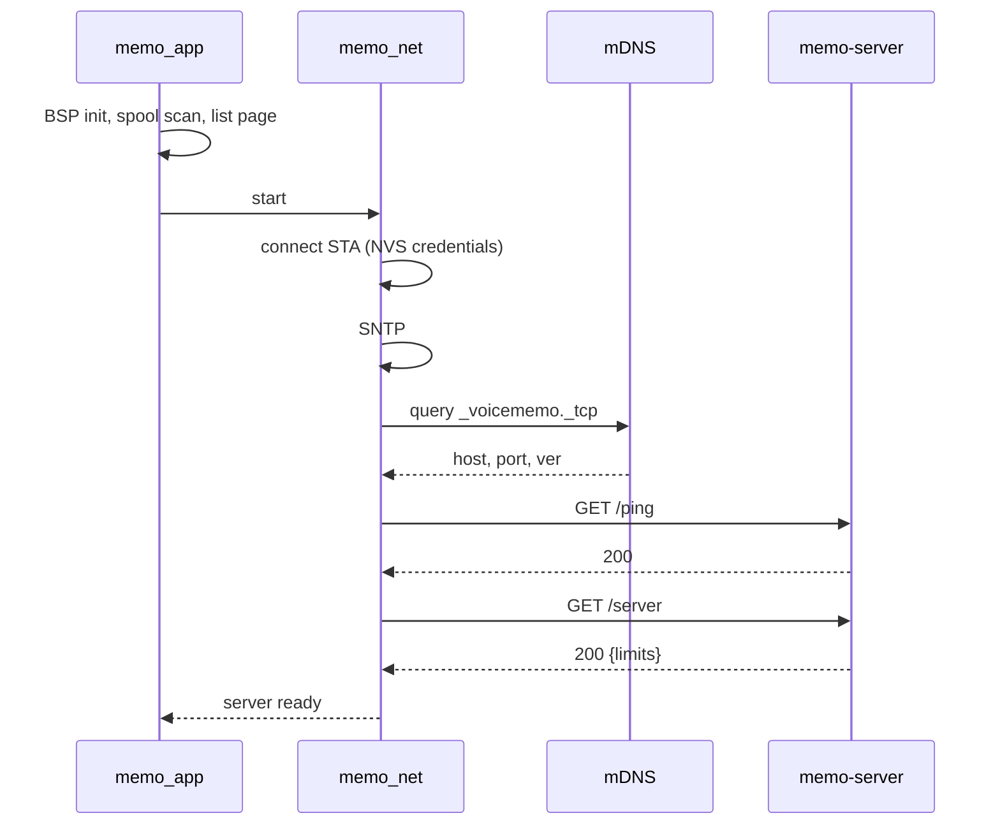
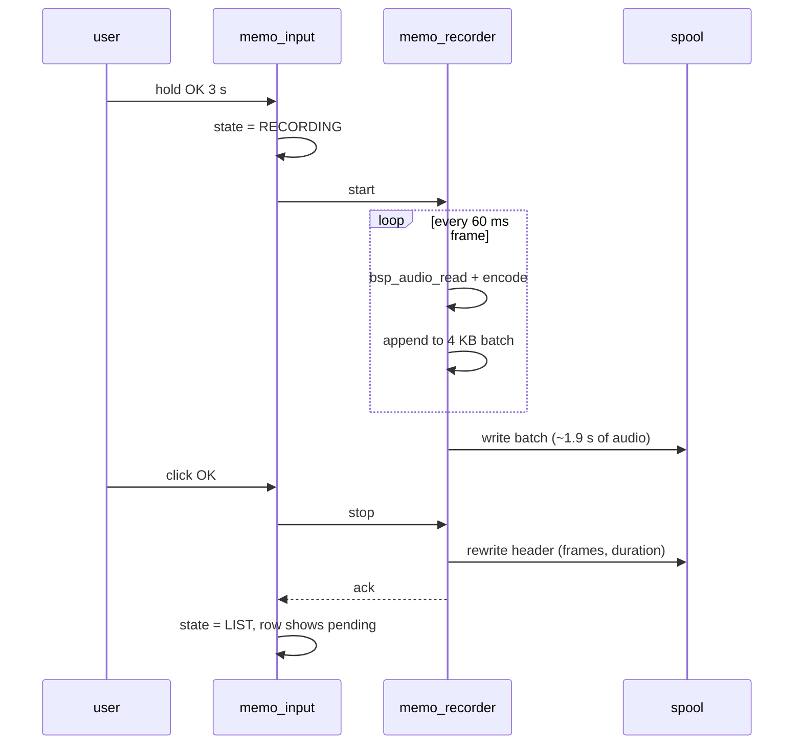
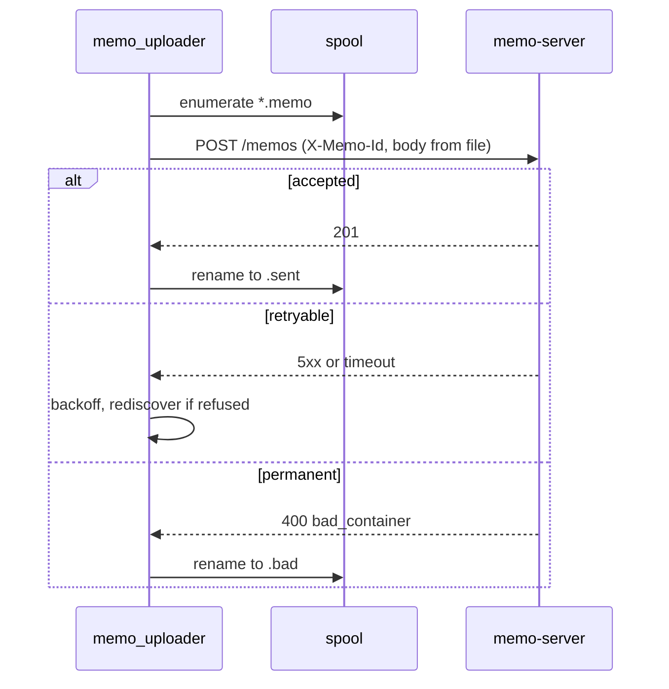
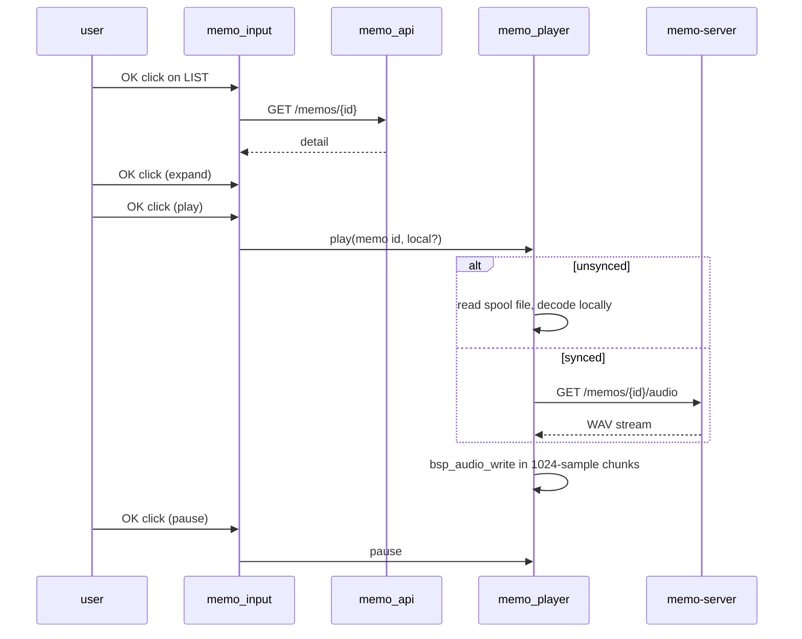
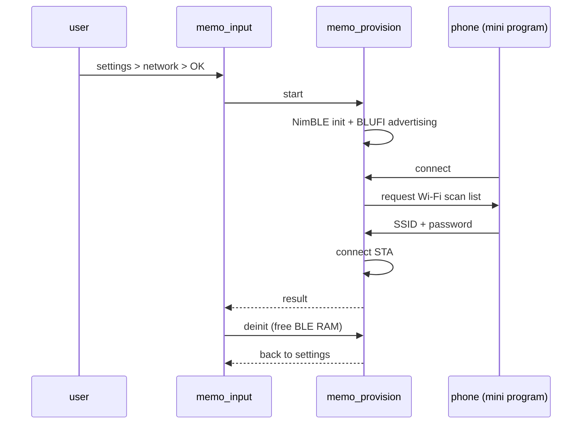

<p align="right">
  <a href="client.zh_CN.md">简体中文</a> · <strong>English</strong>
</p>

# Voice Memo Client — Technical Design

Status: draft for review, 2026-10-26. Product behaviour comes from the
[product specification](../product/product-spec.md); the server contract comes
from the [server design](server.md). This document only describes the device.

## 1. Scope

The device is a thin client: it records, spools, uploads, browses and plays.
Transcription, storage of history and audio decoding live on the server.

In scope: application structure, tasks and concurrency, the screen state
machine, the audio record and playback paths, local spool storage, Wi-Fi
provisioning, service discovery, HTTP client behaviour, power management, the
Chinese font integration, and the test strategy.

Out of scope: anything on the server; the product rules themselves.

## 2. Hardware constraints

These come from `components/bsp/include/bsp_pins.h` and the hardware guide and
are not negotiable in this design.

| Constraint | Consequence |
| --- | --- |
| ESP32-C3, single core, 160 MHz | encoding and rendering compete for the same core; audio work must not be starved by LVGL |
| No PSRAM, ~320 KB SRAM | every buffer is budgeted; no full-memo audio in RAM |
| 8 MB flash | room for a 3.5 MB app (with fonts) plus a 4.4 MB data partition |
| 240×320 display, 3 buttons on one ADC ladder | no keyboard, no touch; all input is up/down/ok with click and hold |
| ES8311 codec, 16 kHz mono full duplex | recording and playback share the codec, never simultaneously |
| USB Serial/JTAG console | logs are available without UART pins |

## 3. Base and what changes

Built on the `ai-passport` baseline (C, ESP-IDF 5.5.3, LVGL 9.5), reusing the
BSP unchanged.

| Baseline piece | Fate |
| --- | --- |
| `components/bsp/*` | kept as-is; no new BSP APIs are required |
| `main/main.c` menu and `main/demo_*.c` | removed from the build; the application shell replaces them |
| `main/ui_pixel.*` | not used (the product spec requires a redesigned UI) |
| `main/demo_low_power.c` | reference only; its ES8311 suspend and pin-hold sequences are followed |
| `tools/validate.sh` | unchanged; new host tests are added to its list |

The UI is new from scratch, as the repository requires for derivative
applications.

## 4. Module layout

```text
main/
├── memo_app.c          app_main, wiring, input dispatch queue
├── memo_state.c/.h     pure state machine: states, inputs, transitions
├── memo_ui_list.c      timeline page
├── memo_ui_detail.c    text and playback page
├── memo_ui_record.c    recording page
├── memo_ui_settings.c  settings and its sub-pages
├── memo_ui_common.c/.h status bar, page chrome, shared widgets
├── memo_font.c         generated CJK subsets (lv_font_conv output)
├── memo_codec.c        the single encode/decode task
├── memo_recorder.c/.h  audio in -> Opus -> spool (runs on memo_codec)
├── memo_player.c/.h    WAV stream -> I2S (runs on memo_codec)
├── memo_spool.c/.h     file naming, append, sync marking, boot scan
├── memo_net.c/.h       STA connect, SNTP, reconnect policy
├── memo_discovery.c/.h mDNS query and health probe
├── memo_api.c/.h       HTTP client, JSON parsing, error mapping
├── memo_provision.c/.h BLUFI over NimBLE, on demand only
├── memo_power.c/.h     screen timeout, deep sleep, wake guards
├── memo_text.c/.h      pure text helpers: truncate, wrap, format (host-tested)
└── memo_time.c/.h      pure time helpers: epoch to local, duration format
```

`memo_state`, `memo_text` and `memo_time` have no ESP-IDF or LVGL dependency and
are covered by host tests, as the repository requires for logic that can be
tested off-device.

## 5. Tasks and concurrency

| Task | Prio | Stack | Owns | Blocking |
| --- | ---: | ---: | --- | --- |
| LVGL task (BSP) | 4 | 6 KB | all widget access | draws |
| `memo_input` | 5 | 4 KB | state machine, page switching | never (enqueues and switches) |
| `memo_codec` | 6 | 20 KB | records or plays, never both | codec I/O and network reads |
| `memo_uploader` | 4 | 7 KB | HTTP uploads, spool renames | network |
| `memo_net` | 3 | 4 KB | STA connect, SNTP, discovery retries | network |

Rules that follow from the repository invariants:

- Button callbacks run on the `esp_timer` task and only push an event into a
  8-deep queue. No LVGL, no audio, no flash.
- `memo_input` is the only place that changes pages, and it holds
  `bsp_lvgl_lock()` for each change.
- Recorder and player are mutually exclusive: starting one stops the other and
  waits for its acknowledgement.
- Every page stop is a bounded handshake (semaphore with timeout), then the
  handle is deleted. A timed-out stop keeps the handle for retry and reports a
  visible error rather than leaking a task that can still touch the UI.
- Encoding and decoding share one task, because the product never does both at
  once. That is one 20 KB stack instead of two sized for the worst case, and it
  makes "stop recording before playing" a property of the task rather than a
  rule every caller has to remember.

## 6. State machine

States and the input table live in `memo_state.c`; the UI files only render a
state and never decide transitions.

| State | UP click | DOWN click | OK click | OK hold | UP/DOWN hold |
| --- | --- | --- | --- | --- | --- |
| `LIST` | select previous | select next | open detail | arm recording | open settings |
| `ARMING` | cancel | cancel | cancel | — | cancel |
| `RECORDING` | ignored | ignored | stop and save | cancel and discard | ignored |
| `DETAIL_COLLAPSED` | previous memo | next memo | expand text | back to list | ignored |
| `DETAIL_EXPANDED` | scroll up | scroll down | start playback | back to list | ignored |
| `PLAYING` | scroll up | scroll down | pause | back to list (playback stops) | ignored |
| `PAUSED` | scroll up | scroll down | resume | back to list | ignored |
| `SETTINGS` | previous row | next row | enter sub-page or toggle | back to list | ignored |
| `SUB_PAGE` | change value | change value | save and return | cancel and return | ignored |
| `PROVISIONING` | ignored | ignored | ignored | cancel and return | ignored |
| `ERROR` | ignored | ignored | dismiss | dismiss | ignored |

`ARMING` is entered on an OK hold from `LIST` and lasts three seconds while the
ring fills. A short press that ends before the ring completes returns to `LIST`
without recording, which is what makes "open" and "record" distinguishable on a
single key.

Transitions are expressed as `(state, input) -> (state, action)` in a table, so
the host test can walk every combination and assert that no state is
unreachable and no input is silently dropped.

## 7. Recording path

```text
esp_codec (I2S RX) ──► bsp_audio_read ──► esp_opus_enc ──► RAM batch ──► spool append
    16 kHz mono          512 samples        16 kHz mono      4 KB          4 KB write
    PCM16                (~32 ms)           20 kbps, 60 ms                  (~1.9 s of audio)
```

Encoder settings:

| Parameter | Value | Reason |
| --- | --- | --- |
| sample rate | 16000 | the BSP codec path and the ASR pipeline both use 16 kHz |
| channels | 1 | mono microphone |
| frame duration | 60 ms | matches the server's container contract and the voice-keychain precedent |
| bitrate | 20 kbps target, VBR | ≈ 2.5 KB/s; a 5-minute memo is 0.75 MB |
| complexity | 0 | single-core C3; quality difference at 20 kbps is not worth the CPU |
| DTX | **off** | every frame must exist so frame count and duration match |
| FEC | off | no packet loss on a TCP upload |

Buffering: PCM arrives in 512-sample chunks, the encoder emits one 60 ms frame
per three chunks, and frames accumulate in a 4 KB RAM batch. When the batch is
full it is appended to the spool file in a single write, so flash is touched
about once every 1.6 seconds instead of continuously. The I2S DMA (six 240-frame
descriptors, ~90 ms) absorbs the write, and `CONFIG_I2S_ISR_IRAM_SAFE=y` keeps
the DMA service out of flash-disabled windows.

Duration and frame count are written into the container header when the
recording stops, by seeking back to offset 0 and rewriting the 80 bytes.

Recording stops on OK, on the 5-minute cap, or on a codec error. A stop request
that cannot finish within two seconds leaves the file truncated-but-valid (the
header says how many frames are present) and reports an error to the UI.

## 8. Playback path

```text
GET /api/v1/memos/{id}/audio ──► 16 KB ring ──► bsp_audio_write ──► I2S TX
        WAV, 16 kHz mono            (500 ms)        1024 samples
```

- Before the first write, the player discards the RIFF header and prebuffers
  8 KB so that Wi-Fi jitter does not immediately underrun.
- The ring is 500 ms; a single failed read is retried once, and a real underrun
  is logged and tolerated (a short silence) rather than aborting playback.
- Pause stops feeding and keeps the socket open for a resume; stop closes it.
- Volume comes from the settings value and is applied through
  `bsp_audio_set_volume()` before the first frame.

Playback of an **unsynced** memo reads the local spool file instead of the
network: the same container, decoded by the same Opus decoder into PCM, written
through the same `bsp_audio_write` call. That keeps "recorded a second ago, press
play" working with the network down.

## 9. Local spool

The spool is the durability layer: a recording is finished the moment it hits
flash, and uploading is a background concern.

- Location: SPIFFS partition mounted at `/spool`.
- File name: `<memo_id>.memo` while unsynced, renamed to `<memo_id>.sent` after
  the server accepts it, and `<memo_id>.bad` after a permanent rejection. Names
  are the whole index; no separate metadata file can get out of sync with the
  filesystem.
- File content: exactly the upload container (80-byte header plus
  length-prefixed Opus frames), so upload is a straight file send with a known
  `Content-Length` and no re-wrapping.
- Filter attributes can be enabled for `SPIFFS_OBJ_META_LEN`, but the device
  does not rely on them for correctness.
- Boot: enumerate `/spool`, rebuild the pending list, delete `.sent` files.
- Capacity: at 2.5 KB/s the 4.4 MB partition holds roughly 29 minutes of
  unsynced audio, far beyond the five-minute cap.

The recorder writes; the uploader only reads and renames; the player only reads.
No two tasks open the same file for writing.

## 10. Network

### 10.1 Wi-Fi

STA mode, credentials in NVS, reconnect with exponential backoff (2 s to 60 s,
capped). Credentials are never logged. `memo_net` owns the connect/retry loop so
that neither the UI nor the uploader has to reason about link state.

### 10.2 Provisioning

BLUFI over NimBLE, following the `demo/blufi-provisioning` reference: the
callbacks, the security callbacks and the shared NVS/netif event-loop setup are
all needed, not just one file. The advertised name starts with `BLUFI` so the
WeChat mini program lists it.

Provisioning is started only from the settings page and is torn down when it
finishes or is cancelled: NimBLE and the BLUFI context are deinitialised so that
their RAM is returned to the heap before normal operation resumes. A device that
has valid credentials never starts BLE.

### 10.3 Discovery

`espressif/mdns` as a client: query PTR `_voicememo._tcp`, resolve SRV then A,
cache `host:port` and the TXT `ver`. Then `GET /api/v1/ping` and
`GET /api/v1/server`; only a 200 from both marks the server usable and yields the
`limits` block.

Discovery runs once after associating, and again on every upload failure of the
"connection refused" class. There is no broadcast fallback: if mDNS fails, the
settings page says so and the device keeps recording.

### 10.4 HTTP client

`esp_http_client`, one client per operation, `timeout_ms` 10 s for control calls
and 60 s for upload, `buffer_size` 4096. Uploads stream from the spool file with
`Content-Length` set, so a failed transfer is retryable by resending the same
`X-Memo-Id`.

Error mapping decides the policy:

| Condition | Action |
| --- | --- |
| connect timeout, DNS failure | rediscover, retry with backoff |
| 5xx, 429 | retry with backoff |
| 400 `bad_container`, `frame_mismatch`, `over_limit` | mark `.bad`, surface in settings, never retry |
| 413 | mark `.bad` (a server cap smaller than ours) |
| 200 or 201 | rename to `.sent` |

## 11. Time and settings

- SNTP starts on association; until the first successful sync `recorded_at` is 0
  and the container says so, which the server already handles by substituting
  its own clock.
- Settings live in NVS namespace `memo`: `volume`, `brightness`,
  `screen_timeout_s`, `sleep_min`, `autoplay`, `tz_offset_min`,
  `server_name`, `server_host`.
- Time display uses `tz_offset_min`; every timestamp stored or sent is UTC
  seconds.

## 12. Power management

Two levels, both driven by `memo_power`:

| Level | Trigger | Effect | Wake |
| --- | --- | --- | --- |
| screen off | no input for `screen_timeout_s` | backlight 0, LVGL still running | any key |
| deep sleep | idle for `sleep_min` with no pending uploads and no active playback | the baseline deep-sleep sequence: ES8311 suspend, CW2017 sleep, I2S release, I2C pins released, LCD held | GPIO0 or RTC timer |

Hard rules:

- Recording, playback, provisioning and upload never sleep; recording and
  playback also keep the screen on.
- Pending uploads block deep sleep but allow the screen to turn off; the upload
  finishes, then the idle timer restarts.
- Waking always reboots into `LIST`; the recording page is never restored.
- Screen-off is not "off": the framebuffer still flushes, so the timeout only
  changes the backlight. A later optimisation can stop flushes entirely.

## 13. UI

### 13.1 Fonts

The UI is Chinese and the text is arbitrary ASR output, so the font contract has
to be explicit.

- Two generated subsets with `lv_font_conv`: `memo_font_20` (detail text) and
  `memo_font_16` (list rows), 4 bpp, uncompressed, covering GB2312 level-1
  (3755 characters), common punctuation and printable ASCII. Roughly 1.3 MB of
  flash in total, compiled into the app.
- Each has a writable descriptor with Montserrat as fallback, for icons and any
  Latin glyph with better metrics.
- Coverage is contractual: before rendering, code points are checked with
  `lv_font_get_glyph_dsc()`; a missing glyph renders as a placeholder and logs
  `U+XXXX`. A host test asserts coverage over a fixed corpus and includes a
  deliberately missing code point as a negative case.
- Text is cut on rune boundaries only. `memo_text.c` owns truncation and
  wrapping so it can be tested without a display.

### 13.2 Pages

- **List**: date group headers, one row per memo (`HH:MM`, one-line snippet or a
  status word, duration), the selected row inverted, battery in the top-right,
  a hint line at the bottom.
- **Detail**: transcript block (six lines collapsed, scrollable expanded) above a
  playback bar; the bar shows position and duration.
- **Record**: large timer, a level bar driven by the RMS of the current chunk,
  the two hints, and the record dot.
- **Settings**: seven rows as specified in the product document, each sub-page
  with the same "OK saves, hold cancels" rule.
- **Provisioning**: the advertised BLE name and a state line.

Every page draws the battery indicator from `bsp_battery_soc()` and renders an
icon without a number when the reading is `-1`.

### 13.3 LVGL discipline

All widget access happens in the LVGL task or under `bsp_lvgl_lock()`; worker
tasks publish state into a small struct and, when they must touch the UI, take
the lock for a single label update. No task holds the lock while doing audio or
network work.

## 14. Degradation

| Failure | Device behaviour |
| --- | --- |
| no Wi-Fi | list shows local pending memos only, "offline" hint; recording continues |
| server not discovered | uploader backs off, settings shows "not found"; recording continues |
| upload rejected as malformed | file marked `.bad`, listed with an error badge, never retried |
| transcription failed | list shows the status word; audio still plays |
| codec init failed | recording page replaced by an error state; browsing still works |
| battery gauge missing | icon without a number |
| font missing a glyph | placeholder plus a log line, never a blank cell |

## 15. Partition table

```text
# Name,   Type, SubType, Offset,   Size
nvs,      data, nvs,     0x9000,   0x6000
phy_init, data, phy,     0xf000,   0x1000
factory,  app,  factory, 0x10000,  0x380000
memo,     data, spiffs,  0x390000, 0x470000
```

The app partition holds the firmware plus the two fonts; the data partition
holds the spool. `./tools/validate.sh --firmware` verifies the layout, and the
spiffs partition is formatted on first mount (`format_if_mount_failed = true`).

## 16. Memory budget

| Allocation | Bytes | Notes |
| --- | ---: | --- |
| LVGL pool | 24 K | baseline |
| LCD DMA buffer | 9.6 K | baseline, 240×20 RGB565 |
| I2S DMA | 5.8 K | six 240-frame descriptors |
| Opus encoder | ~40 K | only while recording |
| Opus decoder | ~20 K | only while playing a local memo |
| Record batch | 4 K | |
| Playback ring | 16 K | |
| HTTP client buffers | 8 K | one operation at a time |
| Task stacks | 46 K | six tasks; the codec task alone takes 20 K |
| Wi-Fi | ~40 K | after the tuning in 16.1 |
| NimBLE | ~40 K | provisioning only, freed afterwards |

Peak while recording with Wi-Fi associated is roughly 200 KB; peak during
provisioning is higher but the codec is idle then. The encoder and decoder are
never resident at the same time. This is the tightest part of the design and is
the first thing to measure on real hardware.

### 16.1 Tuning taken from the reference project

The XiaoZhi firmware runs the same chip with no PSRAM and is exercised by an
upstream build matrix, so its memory configuration is a safer starting point
than my estimates.

| Setting | Reference value | Effect |
| --- | --- | --- |
| `ESP_WIFI_STATIC_RX_BUFFER_NUM` | 3 (default 6) | fewer permanently allocated Wi-Fi buffers |
| `ESP_WIFI_DYNAMIC_RX_BUFFER_NUM` | 6 | |
| `ESP_WIFI_RX_BA_WIN` | 3 | smaller block-ack window |
| `LWIP_TCPIP_RECVMBOX_SIZE` | 16 | |
| `LWIP_IPV6` | off | no IPv6 structures at all |
| `ESP_WIFI_ENABLE_WPA3_SAE` | off | no SAE state |
| `ESP_WIFI_ESPNOW_MAX_ENCRYPT_NUM` | 0 | |
| `ESP_WIFI_IRAM_OPT`, `ESP_WIFI_RX_IRAM_OPT` | off | gives IRAM back, accepts slower Wi-Fi paths |
| `FREERTOS_IDLE_TASK_STACKSIZE` | 768 (default 1536) | |
| `LV_USE_CLIB_MALLOC` | on | LVGL allocates from the system heap instead of its own TLSF, so there is one allocator and one fragmentation story |
| unused LVGL widgets | chart, calendar, keyboard, list, menu, msgbox, span, spinbox, spinner, tabview, tileview, win, animimg, led all off | flash and pool |
| `LV_FONT_FMT_TXT_LARGE` | on | required for a 3755-glyph font |
| LVGL draw buffer | `width × 20`, single buffered | 9.6 KB, same as the baseline |

Two deliberate deviations:

- The reference disables `LV_USE_FONT_PLACEHOLDER`. We keep it enabled: a missing
  glyph must be visible during development, as the repository font guide requires.
- The reference lowers the LVGL task to priority 1. We leave it at the BSP
  default of 4 and keep the codec task above it, because the record page draws
  more often than an idle emote screen; if rendering stutters during recording,
  dropping LVGL to 3 is the first knob.

Encoder and decoder are heap allocations in both designs; the 20 KB figure is
stack, which is why the merged task needs the headroom the reference gives its
`opus_codec` task (24 KB there).

## 17. Sequence diagrams

### 17.1 Boot and discovery



### 17.2 Recording



### 17.3 Upload



### 17.4 Browse and play



### 17.5 Provisioning



## 18. Testing

Host tests (no device, no ESP-IDF) cover the parts that can be wrong invisibly:

| File under test | Cases |
| --- | --- |
| `memo_state` | full transition table, unreachable states, hold timing boundaries, ignored inputs |
| `memo_text` | truncation on rune boundaries, wrapping, ellipsis at the right place, wide-character handling |
| `memo_time` | epoch to local with positive and negative offsets, duration formatting past an hour |
| `memo_spool` (filename logic) | parse, sort, classify `.memo`/`.sent`/`.bad`, reject malformed names |
| container header | build and parse round-trip, frame count and duration arithmetic |
| retry policy | backoff schedule, permanent versus retryable classification |
| font coverage | corpus of expected characters present, one known-missing rejected |

On the device, the acceptance list from the product document applies; the
firmware gate (`./tools/validate.sh --firmware`) proves the build and the
partition layout, not the behaviour.

## 19. Build changes

- `main/CMakeLists.txt`: replace the demo sources with the `memo_*` sources, add
  `memo_font.c`, and require `esp_http_client`, `json`, `nvs_flash`, `esp_wifi`,
  `mdns`, `bt`, `wifi_provisioning`, `esp_audio_codec`.
- `main/idf_component.yml`: `espressif/mdns`, `espressif/esp_audio_codec`,
  `espressif/button` (already via the BSP).
- `sdkconfig.defaults`: `CONFIG_I2S_ISR_IRAM_SAFE=y`, `CONFIG_LV_USE_QRCODE=n`,
  `CONFIG_BT_NIMBLE_ENABLED=y`, `CONFIG_MBEDTLS_*` sized down later if TLS is
  ever used, plus the memory tuning listed in 16.1 —
  `CONFIG_ESP_WIFI_STATIC_RX_BUFFER_NUM=3`,
  `CONFIG_ESP_WIFI_DYNAMIC_RX_BUFFER_NUM=6`, `CONFIG_ESP_WIFI_RX_BA_WIN=3`,
  `CONFIG_LWIP_TCPIP_RECVMBOX_SIZE=16`, `CONFIG_LWIP_IPV6=n`,
  `CONFIG_ESP_WIFI_ENABLE_WPA3_SAE=n`, `CONFIG_ESP_WIFI_ESPNOW_MAX_ENCRYPT_NUM=0`,
  `CONFIG_ESP_WIFI_IRAM_OPT=n`, `CONFIG_ESP_WIFI_RX_IRAM_OPT=n`,
  `CONFIG_FREERTOS_IDLE_TASK_STACKSIZE=768`, `CONFIG_LV_USE_CLIB_MALLOC=y`,
  `CONFIG_LV_FONT_FMT_TXT_LARGE=y`.
- `partitions.csv`: the table in section 15.
- `dependencies.lock`: regenerated once the manifests change.

## 20. Risks

1. **RAM headroom.** Section 16 is an estimate. The first task on hardware is to
   measure the heap high-water mark while recording with Wi-Fi up, and while
   provisioning.
2. **Flash writes during recording.** Mitigated by batching and IRAM-safe I2S,
   but only real recordings prove it.
3. **Encoder CPU on one core.** Complexity 0 keeps it small; if LVGL stutters
   during recording, the record page will be simplified before the encoder is
   touched.
4. **mDNS reliability** on cheap routers; no fallback is planned, which is a
   deliberate product decision and should be revisited if it bites.
5. **Font size.** Two 4 bpp subsets is ~1.3 MB; if flash gets tight, the 16 px
   list font drops first and the list uses the 20 px font.

## 21. Open questions

1. Should the record page show a live waveform instead of a level bar? A bar
   costs no extra buffer; a waveform needs a rolling history.
2. Should playback of an unsynced memo be marked differently from playback of a
   synced one? Currently identical, which is arguably right.
3. Screen-off currently only dims the backlight; whether to also stop flushes is
   a power question that needs measurement.
