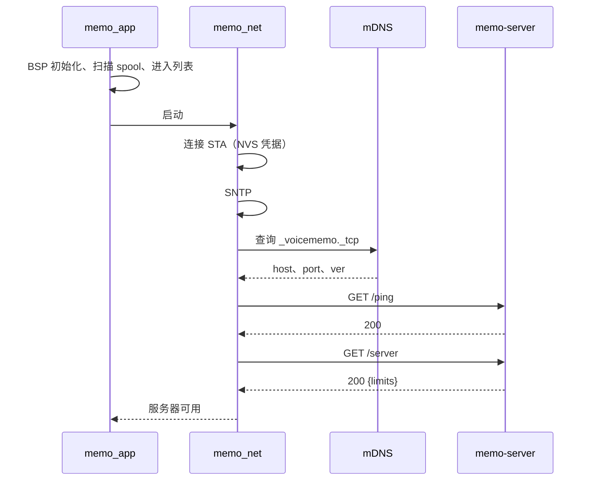
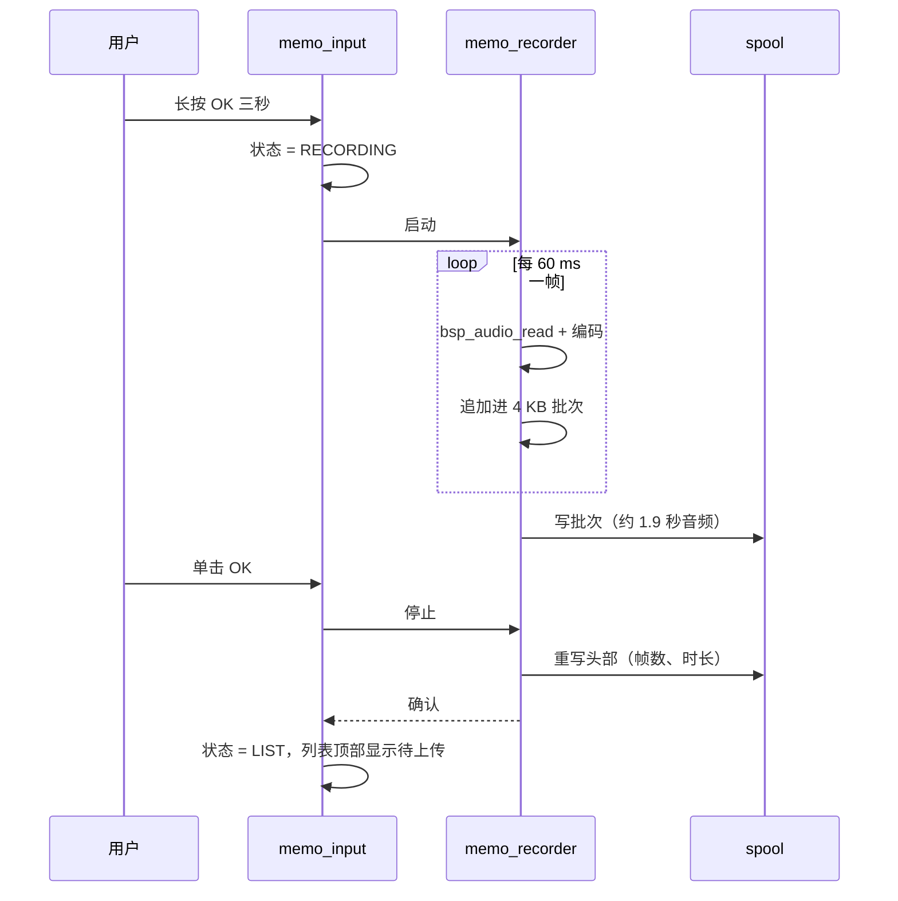
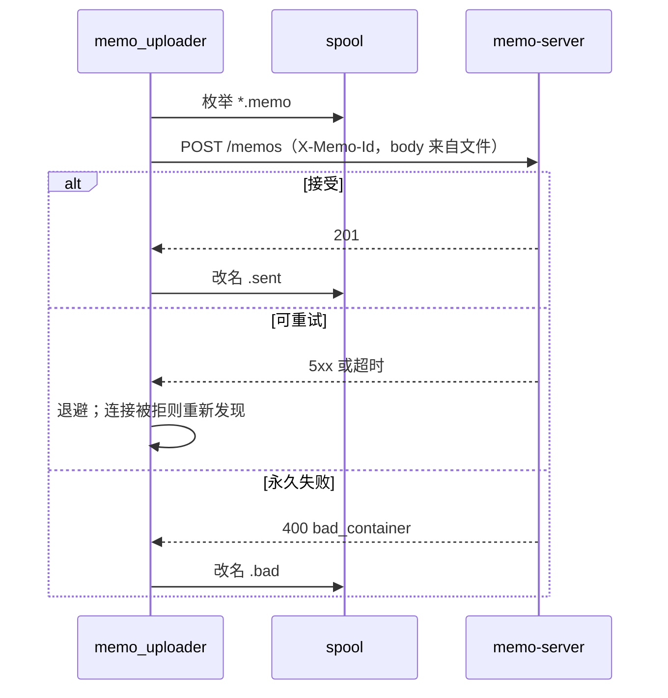
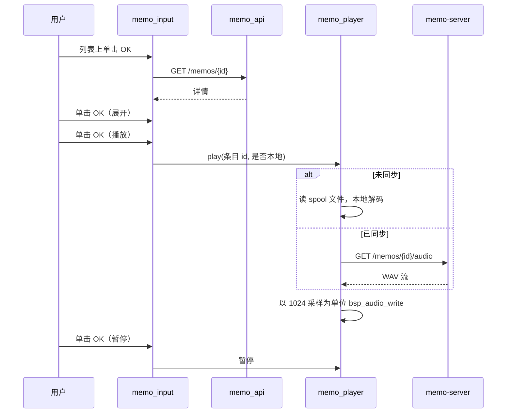
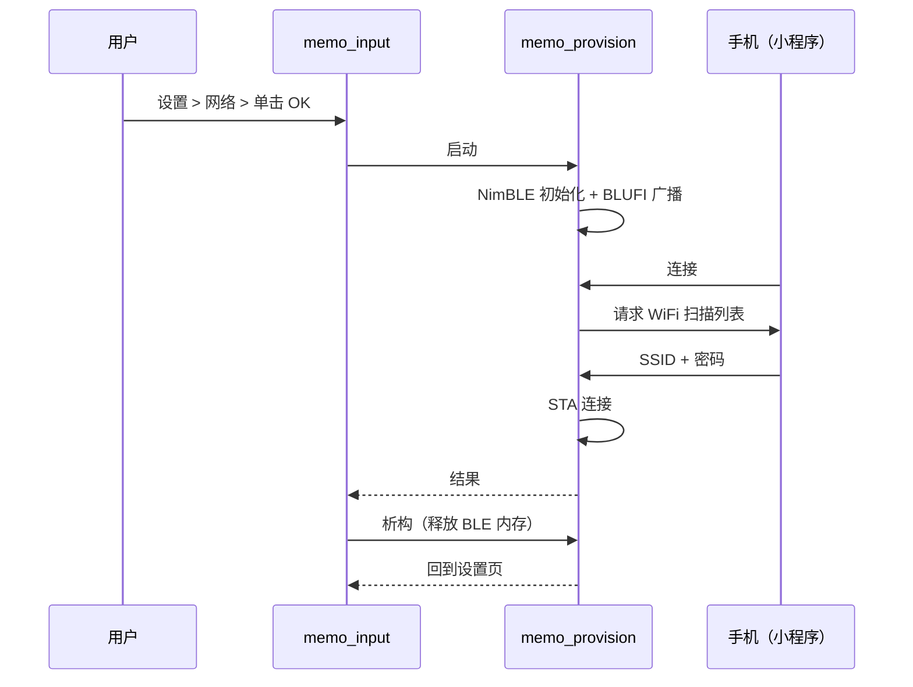

<p align="right">
  <a href="client.md">English</a> · <strong>简体中文</strong>
</p>

# 语音日记设备端 — 技术方案

状态：评审稿，2026-10-26。产品行为以[产品方案](../product/product-spec.zh_CN.md)为准，
服务端契约以[服务端方案](server.zh_CN.md)为准。本文只描述设备。

## 1. 范围

设备是瘦客户端：负责录音、落盘、上传、翻阅、播放。转写、历史存储、音频解码都在服务器。

范围内：应用结构、任务与并发、界面状态机、录音与播放两条音频通路、本地 spool 存储、
WiFi 配网、服务发现、HTTP 客户端行为、电源管理、中文字体集成、测试策略。

范围外：服务器侧的一切；产品规则本身。

## 2. 硬件约束

来自 `components/bsp/include/bsp_pins.h` 与硬件开发指南，本设计不改变它们。

| 约束 | 后果 |
| --- | --- |
| ESP32-C3，单核 160 MHz | 编码和渲染抢同一个核，音频任务不能被 LVGL 饿死 |
| 无 PSRAM，约 320 KB SRAM | 每个缓冲区都要报账，内存里放不下整条录音 |
| 8 MB Flash | 装得下 3.5 MB 应用（含字体）和 4.4 MB 数据分区 |
| 240×320 屏，三键共用一路 ADC 分压 | 没有键盘、没有触摸；输入只有上下确定的单击与长按 |
| ES8311，16 kHz 单声道全双工 | 录音与播放共用 codec，永不并行 |
| USB Serial/JTAG 控制台 | 不接 UART 也能看日志 |

## 3. 基线与取舍

基于 `ai-passport` 基线（C、ESP-IDF 5.5.3、LVGL 9.5），BSP 原样复用。

| 基线内容 | 处理 |
| --- | --- |
| `components/bsp/*` | 保持原样，不需要新增 BSP 接口 |
| `main/main.c` 菜单与 `main/demo_*.c` | 移出构建，应用外壳取代它们 |
| `main/ui_pixel.*` | 不使用（产品要求重新设计界面） |
| `main/demo_low_power.c` | 仅作参考，沿用它的 ES8311 挂起与引脚保持序列 |
| `tools/validate.sh` | 不改，新增的宿主测试挂进它的列表 |

界面全部新写，这是仓库对派生应用的硬要求。

## 4. 模块划分

```text
main/
├── memo_app.c          应用入口、装配、输入队列
├── memo_state.c/.h     纯状态机：状态、输入、迁移
├── memo_ui_list.c      时间轴页
├── memo_ui_detail.c    文字与播放页
├── memo_ui_record.c    录音页
├── memo_ui_settings.c  设置页及其子页
├── memo_ui_common.c/.h 状态栏、页面骨架、共用控件
├── memo_font.c         lv_font_conv 生成的中文子集
├── memo_recorder.c/.h  音频输入 → Opus → spool
├── memo_player.c/.h    WAV 流 → I2S
├── memo_spool.c/.h     文件命名、追加、标记、启动扫描
├── memo_net.c/.h       STA 连接、SNTP、重连策略
├── memo_discovery.c/.h mDNS 查询与健康探测
├── memo_api.c/.h       HTTP 客户端、JSON 解析、错误映射
├── memo_provision.c/.h BLUFI over NimBLE，按需启用
├── memo_power.c/.h     熄屏、深度休眠、唤醒守卫
├── memo_text.c/.h      纯文本工具：截断、换行、格式化（宿主测试）
└── memo_time.c/.h      纯时间工具：epoch 转本地、时长格式化
```

`memo_state`、`memo_text`、`memo_time` 不依赖 ESP-IDF 与 LVGL，由宿主测试覆盖，
符合仓库"可测逻辑必须能在设备外测"的规则。

## 5. 任务与并发

| 任务 | 优先级 | 栈 | 负责 | 阻塞 |
| --- | ---: | ---: | --- | --- |
| LVGL 任务（BSP） | 4 | 6 KB | 全部控件访问 | 绘制 |
| `memo_input` | 5 | 4 KB | 状态机、页面切换 | 从不（只入队与切页） |
| `memo_recorder` | 6 | 6 KB | codec 输入、编码、spool 追加 | `bsp_audio_read` |
| `memo_uploader` | 4 | 7 KB | HTTP 上传、spool 改名 | 网络 |
| `memo_player` | 5 | 5 KB | HTTP 读取、WAV 解析、`bsp_audio_write` | 网络与 codec 输出 |
| `memo_net` | 3 | 4 KB | STA 连接、SNTP、发现重试 | 网络 |

遵循仓库不变量的几条规则：

- 按键回调跑在 `esp_timer` 任务上，只往 8 深的队列里塞事件。不碰 LVGL、不碰音频、不写 flash。
- `memo_input` 是唯一改页面的地方，每次改动都持 `bsp_lvgl_lock()`。
- 录音与播放互斥：启动其一时先停另一个，并等它确认。
- 每次停页都是有界握手（带超时的信号量），然后删句柄。超时则保留句柄以便重试，并把错误
  显示出来，而不是留下一个还能碰 UI 的孤儿任务。

## 6. 状态机

状态与输入表放在 `memo_state.c`；UI 文件只负责渲染某个状态，永远不自己决定迁移。

| 状态 | UP 单击 | DOWN 单击 | OK 单击 | OK 长按 | UP/DOWN 长按 |
| --- | --- | --- | --- | --- | --- |
| `LIST` | 上一条 | 下一条 | 打开详情 | 进入录音待发 | 打开设置 |
| `ARMING` | 取消 | 取消 | 取消 | — | 取消 |
| `RECORDING` | 忽略 | 忽略 | 停止并保存 | 取消并丢弃 | 忽略 |
| `DETAIL_COLLAPSED` | 上一条 | 下一条 | 展开全文 | 返回列表 | 忽略 |
| `DETAIL_EXPANDED` | 上滚 | 下滚 | 开始播放 | 返回列表 | 忽略 |
| `PLAYING` | 上滚 | 下滚 | 暂停 | 返回列表（停止播放） | 忽略 |
| `PAUSED` | 上滚 | 下滚 | 继续播放 | 返回列表 | 忽略 |
| `SETTINGS` | 上一行 | 下一行 | 进入子页或就地切换 | 返回列表 | 忽略 |
| `SUB_PAGE` | 改值 | 改值 | 保存并返回 | 取消并返回 | 忽略 |
| `PROVISIONING` | 忽略 | 忽略 | 忽略 | 取消并返回 | 忽略 |
| `ERROR` | 忽略 | 忽略 | 关闭 | 关闭 | 忽略 |

`ARMING` 由 `LIST` 上的 OK 长按进入，持续三秒、圆环填满；在此之前松手回 `LIST` 且不录音。
这就是一个键上"打开"和"录音"能区分开的原因。

迁移写成 `(状态, 输入) -> (状态, 动作)` 的表，宿主测试可以穷举所有组合，断言没有不可达
状态、也没有被静默丢弃的输入。

## 7. 录音通路

```text
esp_codec (I2S RX) ──► bsp_audio_read ──► esp_opus_enc ──► RAM 批次 ──► spool 追加
    16 kHz 单声道        512 采样            16 kHz 单声道      4 KB        4 KB 一次写
    PCM16                （约 32 ms）        20 kbps、60 ms                （约 1.9 秒音频）
```

编码参数：

| 参数 | 值 | 理由 |
| --- | --- | --- |
| 采样率 | 16000 | BSP codec 通路与 ASR 链路都用 16 kHz |
| 声道 | 1 | 单麦克风 |
| 帧长 | 60 ms | 与服务端容器契约、voice-keychain 的既有做法一致 |
| 码率 | 目标 20 kbps，VBR | 约 2.5 KB/s，5 分钟一条是 0.75 MB |
| 复杂度 | 0 | 单核 C3；20 kbps 下复杂度带来的质量差抵不上 CPU 代价 |
| DTX | **关闭** | 每帧必须存在，帧数才能与时长对上 |
| FEC | 关闭 | TCP 上传不存在丢包 |

缓冲：PCM 以 512 采样为单位到达，编码器每三块出一帧，帧在 4 KB 的 RAM 批次里累积；
批次满了才一次性追写 spool，flash 大约每 1.6 秒被碰一次，而不是连续写。I2S DMA
（六个 240 帧描述符、约 90 ms）吸收这次写，`CONFIG_I2S_ISR_IRAM_SAFE=y` 保证 DMA
服务不会卡在 flash 关闭窗口里。

停止录音时，回退到偏移 0 重写 80 字节容器头，写入帧数与时长。

录音在 OK、5 分钟上限或 codec 错误时停止。停止请求两秒内完不成，则文件保持"截断但有效"
（头部如实记录已有帧数），并向 UI 报错。

## 8. 播放通路

```text
GET /api/v1/memos/{id}/audio ──► 16 KB 环形缓冲 ──► bsp_audio_write ──► I2S TX
        WAV，16 kHz 单声道            （500 ms）          1024 采样
```

- 第一次写入前丢弃 RIFF 头，并预缓冲 8 KB，避免 Wi-Fi 抖动立刻欠载。
- 环形缓冲 500 ms；单次读失败重试一次，真正欠载只记日志并容忍（短暂静音），不中断播放。
- 暂停停止喂数据但保留连接以便续播；停止则关闭连接。
- 音量取设置值，在第一帧之前通过 `bsp_audio_set_volume()` 生效。

播放**未同步**的条目时，数据源是本地 spool 文件而不是网络：同一个容器、同一个 Opus
解码器解成 PCM、同一条 `bsp_audio_write` 通路。这样"刚录完就按播放"在断网时也成立。

## 9. 本地 spool

spool 是耐久层：录音落进 flash 那一刻就算完成，上传只是后台事务。

- 位置：/spool
- 文件名：未同步为 `<memo_id>.memo`，服务端接受后改名 `<memo_id>.sent`，永久拒绝后改名
  `<memo_id>.bad`。文件名就是全部索引，不存在一份会与文件系统失步的元数据文件。
- 文件内容：与上传容器完全一致（80 字节头 + 长度前缀 Opus 帧），因此上传就是把文件原样
  发出，`Content-Length` 已知，不需要重新封装。
- SPIFFS 可以开启对象元信息，但正确性不依赖它。
- 启动：枚举 /spool，重建待上传列表，删除 `.sent`。
- 容量：2.5 KB/s 下 4.4 MB 分区约存 29 分钟未同步音频，远超五分钟上限。

录音任务只写，上传任务只读加改名，播放任务只读。任何两个任务都不会同时以写方式打开同一
个文件。

## 10. 网络

### 10.1 WiFi

STA 模式，凭据存 NVS，重连用指数退避（2 秒到 60 秒封顶）。凭据永不进日志。连接与重试
循环由 `memo_net` 独占，UI 和上传任务都不需要自己判断链路状态。

### 10.2 配网

BLUFI over NimBLE，参照 `demo/blufi-provisioning`：回调、安全回调，以及共享的 NVS 与
netif 事件循环初始化都必须带上，不是一个文件就够。广播名以 `BLUFI` 开头，微信小程序才
会列出来。

配网只从设置页启动，结束或取消后立刻拆除：NimBLE 与 BLUFI 上下文都要析构，把它们的 RAM
还给堆，再恢复常规运行。已经有有效凭据的设备永远不启动蓝牙。

### 10.3 服务发现

`espressif/mdns` 当客户端用：查 PTR `_voicememo._tcp`，再解析 SRV 与 A，缓存
`host:port` 与 TXT 里的 `ver`。随后请求 `GET /api/v1/ping` 与 `GET /api/v1/server`；
两者都 200 才算服务器可用，并从后者拿到 `limits`。

发现时机：关联成功后一次；以及每次上传遇到"连接被拒"类错误时。没有广播兜底——mDNS 失败
就在设置页如实显示，设备继续录音。

### 10.4 HTTP 客户端

`esp_http_client`，每次操作一个客户端；控制类请求超时 10 秒，上传 60 秒；
`buffer_size` 4096。上传以 `Content-Length` 从 spool 文件流式发送，因此失败后重发同一个
`X-Memo-Id` 即可。

错误映射决定策略：

| 情况 | 动作 |
| --- | --- |
| 连接超时、DNS 失败 | 重新发现，退避重试 |
| 5xx、429 | 退避重试 |
| 400 `bad_container`、`frame_mismatch`、`over_limit` | 标记 `.bad`，在设置页显示，永不重试 |
| 413 | 标记 `.bad`（服务器上限比我们小） |
| 200 或 201 | 改名 `.sent` |

## 11. 时间与设置

- 关联成功后启动 SNTP；首次同步成功之前 `recorded_at` 为 0，容器如实记录，服务端已经会用
  自己的时钟兜底。
- 设置存 NVS 命名空间 `memo`：`volume`、`brightness`、`screen_timeout_s`、`sleep_min`、
  `autoplay`、`tz_offset_min`、`server_name`、`server_host`。
- 显示时间用 `tz_offset_min`；存储与发送的时间一律 UTC 秒。

## 12. 电源管理

两级，都由 `memo_power` 驱动：

| 级别 | 触发 | 效果 | 唤醒 |
| --- | --- | --- | --- |
| 熄屏 | 无输入满 `screen_timeout_s` | 背光归零，LVGL 照常运行 | 任意按键 |
| 深度休眠 | 空闲满 `sleep_min` 且无待上传、无播放 | 基线深睡序列：ES8311 挂起、CW2017 入睡、释放 I2S、释放 I2C 引脚、保持 LCD 引脚 | GPIO0 或 RTC 定时 |

硬规则：

- 录音、播放、配网、上传期间不休眠；录音与播放还要求不熄屏。
- 有待上传时禁止深睡但允许熄屏；传完再重新计时。
- 唤醒一律重启进 `LIST`，绝不恢复录音页。
- "熄屏"目前只是关背光，帧缓冲仍在刷；是否连刷新一起停，需要实测再定。

## 13. 界面

### 13.1 字体

界面是中文，且文本是任意 ASR 输出，字体契约必须写死。

- 用 `lv_font_conv` 生成两个子集：`memo_font_20`（详情正文）与 `memo_font_16`（列表行），
  4 bpp、不压缩，覆盖 GB2312 一级汉字（3755 字）、常用标点与可打印 ASCII。合计约
  1.3 MB flash，编译进 app。
- 各自有一个可写描述符，fallback 到 Montserrat，用于图标和字形更合适的拉丁字符。
- 覆盖率是契约：渲染前用 `lv_font_get_glyph_dsc()` 逐码点检查，缺字渲染成占位符并记
  `U+XXXX`。宿主测试用固定语料断言覆盖，并包含一个故意缺失的码点作为负例。
- 文本只在字符边界截断。截断与换行都归 `memo_text.c`，可以在没有屏幕的情况下测试。

### 13.2 页面

- **列表**：日期分组头，每条一行（`HH:MM`、一行摘要或状态词、时长），选中行反白，
  右上角电量，底部一行提示。
- **详情**：上方文本块（折叠六行，展开可滚），下方播放条显示位置与总时长。
- **录音**：大号计时、按当前块 RMS 驱动的电平条、两行提示、录音红点。
- **设置**：产品文档规定的七行，子页统一"OK 保存、长按取消"。
- **配网**：BLE 广播名与状态行。

每个页面都从 `bsp_battery_soc()` 取电量，读数为 `-1` 时只画图标不画数字。

### 13.3 LVGL 纪律

所有控件访问都在 LVGL 任务里或 `bsp_lvgl_lock()` 之下；工作线程把状态写进一个小结构体，
确实要动 UI 时只取锁改一个 label。任何任务都不在持锁期间做音频或网络操作。

## 14. 降级

| 故障 | 设备行为 |
| --- | --- |
| 无 WiFi | 列表只显示本地待上传条目并提示离线；照常录音 |
| 未发现服务器 | 上传任务退避，设置页显示"未发现"；照常录音 |
| 上传被判为格式错误 | 文件标 `.bad`，列表带错误标识，永不重试 |
| 转写失败 | 列表显示状态词，音频照常播放 |
| codec 初始化失败 | 录音页换成错误态，浏览仍可用 |
| 电量计缺失 | 只画图标不画数字 |
| 字体缺字 | 占位符 + 一行日志，不留空白格 |

## 15. 分区表

```text
# Name,   Type, SubType, Offset,   Size
nvs,      data, nvs,     0x9000,   0x6000
phy_init, data, phy,     0xf000,   0x1000
factory,  app,  factory, 0x10000,  0x380000
memo,     data, spiffs,  0x390000, 0x470000
```

app 分区放固件加两个字体，数据分区放 spool。`./tools/validate.sh --firmware` 会校验布局，
spiffs 首次挂载时格式化（`format_if_mount_failed = true`）。

## 16. 内存预算

| 项 | 字节 | 说明 |
| --- | ---: | --- |
| LVGL 池 | 24 K | 基线 |
| LCD DMA 缓冲 | 9.6 K | 基线，240×20 RGB565 |
| I2S DMA | 5.8 K | 六个 240 帧描述符 |
| Opus 编码器 | 约 40 K | 仅录音时 |
| Opus 解码器 | 约 20 K | 仅播放本地条目时 |
| 录音批次 | 4 K | |
| 播放环形缓冲 | 16 K | |
| HTTP 缓冲 | 8 K | 同一时刻只有一个操作 |
| 任务栈 | 32 K | 五个任务，多数时候空闲 |
| WiFi | 约 50 K | 协议栈与缓冲 |
| NimBLE | 约 40 K | 仅配网期间，之后释放 |

WiFi 已关联时录音的峰值大约 190 KB；配网时峰值更高，但那时 codec 空闲。编码器与解码器
永不共存。这是整个设计里最紧的一块，也是上真机后第一个要量的数。

## 17. 时序图

### 17.1 启动与发现



### 17.2 录音



### 17.3 上传



### 17.4 浏览与播放



### 17.5 配网



## 18. 测试

宿主测试（不需要设备、不需要 ESP-IDF）覆盖那些"错了也看不出来"的部分：

| 被测文件 | 用例 |
| --- | --- |
| `memo_state` | 全量迁移表、不可达状态、长按计时边界、被忽略的输入 |
| `memo_text` | 字符边界截断、换行、省略号位置、宽字符处理 |
| `memo_time` | epoch 转本地（正负偏移）、超过一小时的时长格式 |
| `memo_spool`（命名逻辑） | 解析、排序、分类 `.memo`/`.sent`/`.bad`、拒绝畸形文件名 |
| 容器头 | 构造与解析往返、帧数与时长换算 |
| 重试策略 | 退避时间表、永久与可重试的分类 |
| 字体覆盖 | 期望字符集存在、一个已知缺失码点被拒 |

真机验收按产品方案的清单逐条走；固件门禁（`./tools/validate.sh --firmware`）只证明构建
与分区布局，不证明行为。

## 19. 构建改动

- `main/CMakeLists.txt`：用 `memo_*` 源码替换 demo 源码，加入 `memo_font.c`，声明依赖
  `esp_http_client`、`json`、`nvs_flash`、`esp_wifi`、`mdns`、`bt`、`wifi_provisioning`、
  `esp_audio_codec`。
- `main/idf_component.yml`：`espressif/mdns`、`espressif/esp_audio_codec`、
  `espressif/button`（BSP 已带）。
- `sdkconfig.defaults`：`CONFIG_I2S_ISR_IRAM_SAFE=y`、`CONFIG_LV_USE_QRCODE=n`、
  `CONFIG_BT_NIMBLE_ENABLED=y`；如果将来真的上 TLS，再调小 mbedTLS 的缓冲。
- `partitions.csv`：第 15 节的表。
- `dependencies.lock`：清单变化后重新生成一次。

## 20. 风险

1. **内存余量。** 第 16 节是估算。上真机第一件事就是量"WiFi 已连 + 正在录音"的堆高水位，
   以及配网期间的高水位。
2. **录音期间的 flash 写。** 靠批处理与 IRAM-safe I2S 缓解，但只有真实录音能证明。
3. **单核上的编码 CPU。** 复杂度 0 已经很低；如果录音时 LVGL 卡顿，先简化录音页，再动编码器。
4. **便宜路由器上的 mDNS 可靠性。** 没有兜底是有意的产品决定，真被咬了再回来看。
5. **字体体积。** 两个 4 bpp 子集约 1.3 MB；flash 紧张时先砍 16 px 列表字体，列表改用
   20 px。

## 21. 待定

1. 录音页要不要实时波形而不是电平条？电平条不需要额外缓冲，波形需要一段滚动历史。
2. 播放未同步条目要不要与已同步的做视觉区分？目前一致，理由是这样更诚实。
3. "熄屏"现在只关背光，要不要连帧刷新一起停，属于需要实测的功耗问题。
