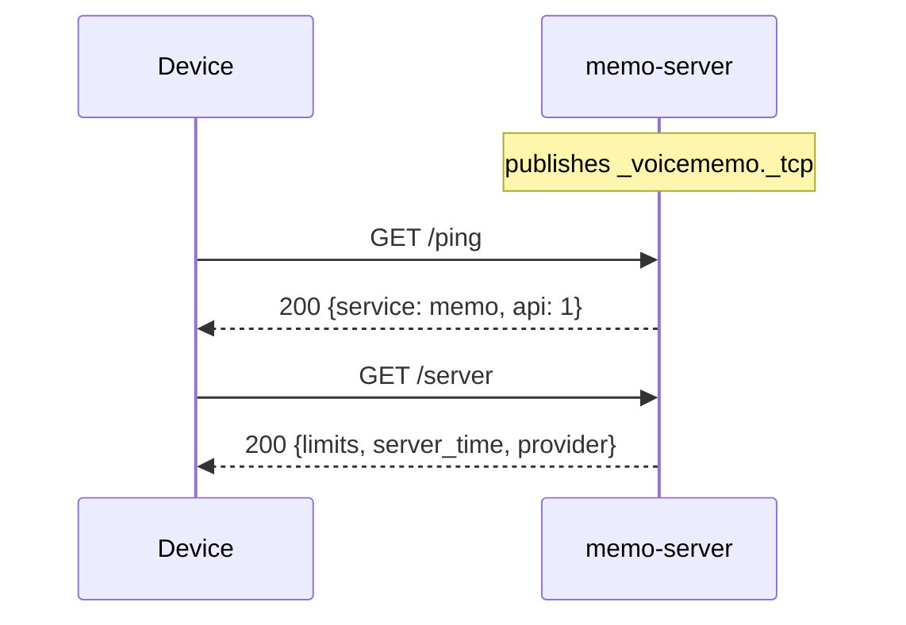
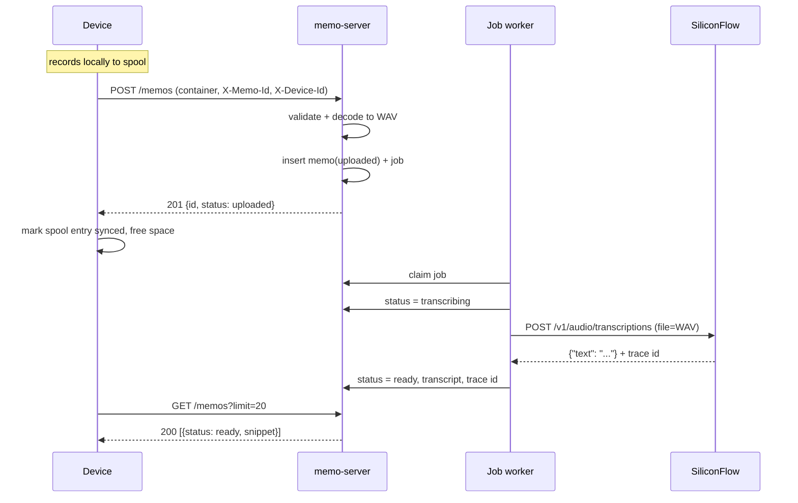
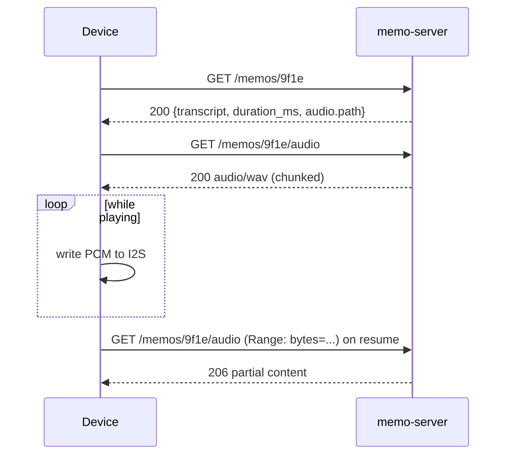
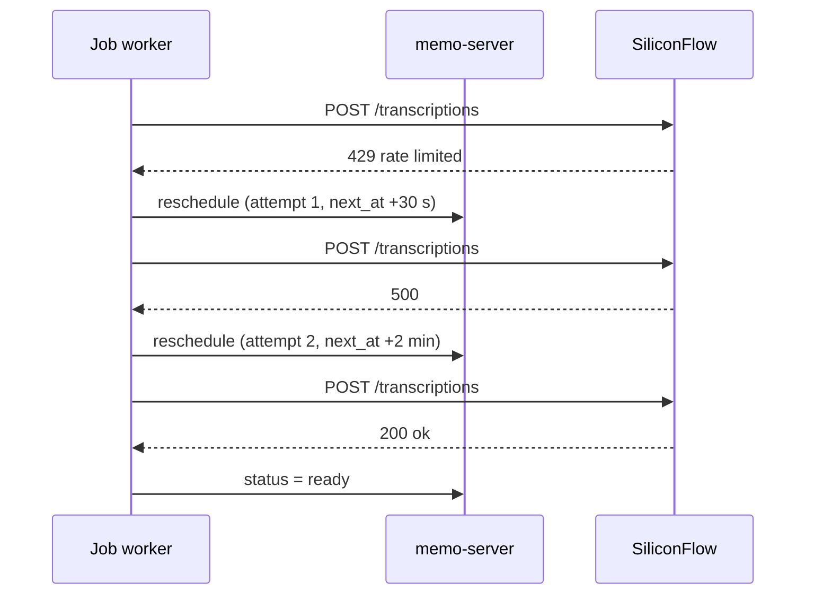
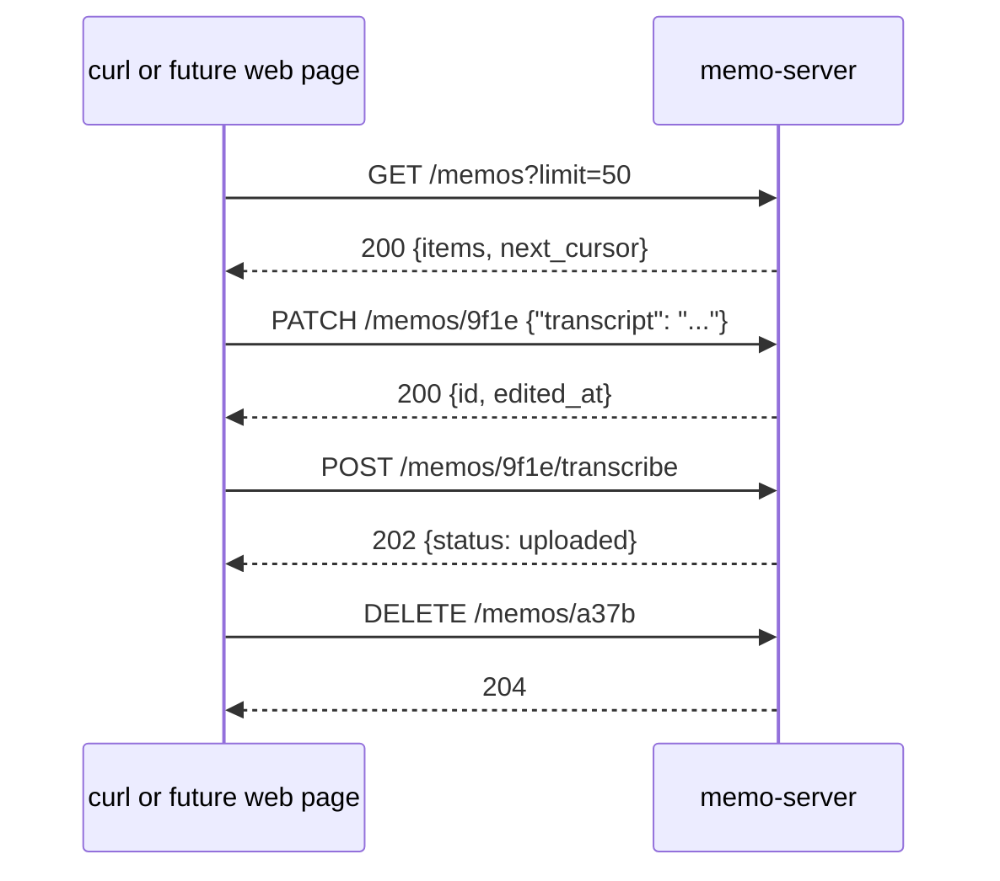

<p align="right">
  <a href="server.zh_CN.md">简体中文</a> · <strong>English</strong>
</p>

# Voice Memo Server — Technical Design

Status: draft for review, 2026-10-26. Client-side design is separate and not
covered here.

## 1. Scope

The server receives finished recordings from the Passport, keeps them, turns
each one into text with a hosted speech-to-text API, and serves the resulting
list back to the device. It also exposes a complete management surface so other
tools can curate the diary.

In scope: upload validation, audio decoding, transcription, metadata queries,
audio streaming, full CRUD over memos, discovery advertisement, deployment.

Out of scope: recording, playback or UI logic on the device; user accounts;
multi-tenant access; a web UI.

Non-goals that shape the design: no message broker, no reverse proxy, no
external database, no `ffmpeg`, no cgo, no device provisioning protocol. One
process, one directory, one binary.

This is a trusted-LAN service. It has no authentication; section 13 states the
consequence plainly rather than pretending otherwise.

## 2. Technology choices

| Concern | Choice | Why |
| --- | --- | --- |
| Language | Go 1.27.3 | current toolchain on the development host; stdlib routing, `log/slog`, `database/sql` |
| HTTP | `net/http` + `http.ServeMux` | method-and-wildcard patterns cover every route, no framework |
| Records | SQLite via `modernc.org/sqlite` | pure Go, no cgo, single file, WAL |
| Audio decode | `github.com/pion/opus` | pure Go; bit-exact for 16 kHz mono SILK, which is exactly the device's encoder setting |
| Discovery | `github.com/grandcat/zeroconf` | pure Go mDNS publisher |
| Speech-to-text | SiliconFlow transcription API | see section 4 |
| Build | `CGO_ENABLED=0 go build -trimpath -ldflags="-s -w"` | one static binary, no runtime libraries |

`pion/opus` is chosen over the cgo wrappers because it removes the entire native
toolchain from deployment. If the device ever moves to CELT or higher bitrates,
`github.com/skrashevich/go-opus` exposes the same API and can be swapped with a
single `replace` line in `go.mod`; that escape hatch is why decoding sits behind
our own function rather than being called from handlers.

## 3. Process and package layout

```text
server/
├── cmd/memo-server/main.go     flags, config, wiring, small CLI
├── internal/config/            environment parsing and validation
├── internal/domain/            Memo, Device, Status, container header
├── internal/audio/             opus frame decode, WAV writer
├── internal/store/             SQLite queries and file layout
├── internal/httpapi/           routes, JSON errors, Range handling
├── internal/asr/               Transcriber interface, siliconflow, fake
├── internal/jobs/              single-writer work loop
└── internal/discovery/         mDNS advertisement
```

One process, three long-lived goroutines: the HTTP server, the job worker, and
the mDNS advertiser. Everything else is request-scoped.

## 4. External dependencies

### 4.1 SiliconFlow transcription

| Item | Value |
| --- | --- |
| Endpoint | `POST https://api.siliconflow.cn/v1/audio/transcriptions` |
| Auth | `Authorization: Bearer <API key>` |
| Body | `multipart/form-data`: `file` (audio), `model` (required) |
| Model | `FunAudioLLM/SenseVoiceSmall` (default), `TeleAI/TeleSpeechASR` (alternative) |
| Limits | duration ≤ 1 hour, file ≤ 50 MB |
| Response | `{"text": "..."}`, plus header `x-siliconcloud-trace-id` |
| Formats | WAV, MP3, OGG, M4A, FLAC |

Our own limits are stricter than the provider's: 5 minutes and 32 MB per memo,
enforced at upload. A decoded 5-minute 16 kHz mono WAV is 9.6 MB, inside both.

The API key comes from the environment only. It is never written to the
database, logs, or responses. The adapter sends one file and receives one
string; nothing about the provider leaks past the `asr` package.

### 4.2 Discovery

mDNS service `_voicememo._tcp`, instance name configurable (default: hostname),
TXT records `ver=1`, `path=/api/v1`, `caps=opus`. The advertised port is the HTTP
port. The device resolves this record and then calls `GET /api/v1/ping` to
confirm reachability, so a stale record is never mistaken for a working server.

mDNS uses multicast, which does not cross Docker's default bridge network.
Deployment is either a native binary under systemd or a container with
`--network host`.

## 5. Component interfaces

Only two seams are real abstractions; the rest is concrete code.

### 5.1 Speech-to-text

```go
package asr

type Input struct {
    AudioPath string        // decoded 16 kHz mono WAV
    Duration  time.Duration
    Language  string        // "" means auto-detect
}

type Result struct {
    Text     string
    Language string
    Provider string
    Model    string
    TraceID  string
}

type Transcriber interface {
    Name() string
    Transcribe(ctx context.Context, in Input) (Result, error)
}
```

Errors are classified rather than string-matched:

```go
var ErrPermanent = errors.New("permanent transcription failure") // do not retry
// wrapped: fmt.Errorf("%w: %v", ErrPermanent, cause)
```

Implementations: `siliconflow.go`, `fake.go` (fixed text, used by tests and
offline development), and optionally `exec.go` (shells out to a local command)
to prove the seam is real. Selection: `MEMO_ASR_PROVIDER`.

### 5.2 Audio decoding

```go
package audio

// DecodeOpusToWAV reads a MEMO container from r, decodes every Opus frame at
// 16 kHz mono, and writes a RIFF/WAVE file to w. It returns the frame count and
// the decoded duration so the caller can cross-check the header.
func DecodeOpusToWAV(r io.Reader, w io.Writer) (Stats, error)
```

A function rather than an interface is deliberate: there is exactly one on-disk
format, and a second codec would change the container version anyway.

### 5.3 Store

`internal/store` is a concrete type over `*sql.DB`, not an interface. Tests use
a real temporary SQLite file, which is faster and more honest than a mock.

## 6. Data model

```sql
CREATE TABLE devices (
    id          TEXT PRIMARY KEY,          -- 12 hex chars derived from the MAC
    name        TEXT,
    first_seen  INTEGER NOT NULL,
    last_seen   INTEGER NOT NULL
);

CREATE TABLE memos (
    id           TEXT PRIMARY KEY,         -- UUIDv4, chosen by the device
    device_id    TEXT NOT NULL,
    recorded_at  INTEGER NOT NULL,         -- device clock, Unix seconds
    uploaded_at  INTEGER NOT NULL,
    duration_ms  INTEGER NOT NULL,
    frame_count  INTEGER NOT NULL,
    size_bytes   INTEGER NOT NULL,
    codec        TEXT NOT NULL,            -- opus
    status       TEXT NOT NULL,            -- uploaded | transcribing | ready | failed
    transcript   TEXT,
    lang         TEXT,
    asr_provider TEXT,
    asr_model    TEXT,
    asr_trace_id TEXT,
    edited_at    INTEGER,                  -- set when a human corrected the text
    error        TEXT,
    audio_path   TEXT NOT NULL,
    clock_skew   INTEGER NOT NULL DEFAULT 0,
    deleted_at   INTEGER                   -- soft delete, audio removed
);

CREATE INDEX memos_order ON memos(recorded_at DESC, id DESC)
    WHERE deleted_at IS NULL;

CREATE TABLE jobs (
    id        INTEGER PRIMARY KEY AUTOINCREMENT,
    memo_id   TEXT NOT NULL UNIQUE,
    attempts  INTEGER NOT NULL DEFAULT 0,
    next_at   INTEGER NOT NULL
);
```

`devices` has no token and no state: it exists only to name the source of a memo,
and is created on first sight of an unknown `X-Device-Id`.

Files: `data/audio/<device_id>/<YYYYMM>/<memo_id>.wav`. The decoded WAV is the
only canonical copy; the uploaded Opus container is deleted after a successful
decode. If decoding fails, the container is kept under `data/rejected/` for
diagnosis.

## 7. HTTP API

All paths are prefixed `/api/v1`. JSON in, JSON out, except the upload body and
the audio stream. There is no authentication and no per-device scoping: every
caller sees every memo.

| Method | Path | Purpose |
| --- | --- | --- |
| GET | `/ping` | Reachability probe used after discovery |
| GET | `/server` | Version, advertised limits, server time, provider |
| POST | `/memos` | Upload one finished recording |
| GET | `/memos` | Keyset-paginated list, newest first |
| GET | `/memos/{id}` | One record with transcript |
| PATCH | `/memos/{id}` | Correct the transcript or language by hand |
| DELETE | `/memos/{id}` | Delete the record and its audio |
| GET | `/memos/{id}/audio` | WAV stream, `Range` supported |
| POST | `/memos/{id}/transcribe` | Re-run transcription |
| GET | `/health` | Ops view: queue depth, provider, disk use |

The management surface is REST-complete on purpose: anything a future web page,
a shell script or a phone shortcut needs can be done over HTTP, and the CLI is a
convenience rather than the only way in.

### 7.1 Device identification

No registration, no token, no approval step. The device sends its own id:

```http
X-Device-Id: A1B2C3D4E5F6
```

The first request mentioning an unknown id creates the device row. The id is
recorded on every memo and echoed in responses, which is enough to tell two
devices apart. A missing id is accepted for reads; uploads require one, because a
memo without a source cannot be attributed later.

### 7.2 Server information

```http
GET /api/v1/server
```

```json
200 OK
{"service":"memo-server","version":"0.1.0","api":1,
 "server_time":1761468200,
 "asr":{"provider":"siliconflow","model":"FunAudioLLM/SenseVoiceSmall"},
 "limits":{"max_memo_ms":300000,"max_bytes":33554432}}
```

`limits` lives on the server so the five-minute cap is defined in one place
instead of drifting between firmware and service.

### 7.3 Upload

```http
POST /api/v1/memos
Content-Type: application/octet-stream
X-Device-Id: A1B2C3D4E5F6
X-Memo-Id: 9f1e5c7a-...
X-Recorded-At: 1761468120
Content-Length: 192044          (optional; chunked bodies are accepted)

<MEMO container bytes>
```

```json
201 Created
{"id":"9f1e5c7a-...","status":"uploaded","duration_ms":84000}
```

Repeating the same `X-Memo-Id` returns `200` with the existing record and does
not create a second job. That idempotency is what lets the device retry bluntly
after a timeout.

The body streams to `data/incoming/<memo_id>.part` with a byte cap, is then
validated (section 8), decoded, and moved into place. Nothing touches the
database until validation passes, so a truncated upload leaves only a temp file
that startup cleanup removes.

### 7.4 Listing

```http
GET /api/v1/memos?limit=20&cursor=MTc2MTQ2MzAyMDpkMWYy&device=A1B2C3D4E5F6
```

```json
200 OK
{"items":[
   {"id":"9f1e...","device_id":"A1B2...","recorded_at":1761468120,
    "duration_ms":84000,"status":"ready","lang":"zh",
    "snippet":"Reviewed the test plan with Zhang…"},
   {"id":"a37b...","device_id":"A1B2...","recorded_at":1761463020,
    "duration_ms":46000,"status":"transcribing"}
 ],
 "next_cursor":"MTc2MTQ2MzAyMDphMzdi"}
```

`limit` defaults to 20 and is capped at 100. `device` is an optional filter. The
cursor is an opaque base64 of `recorded_at:id`, so pagination is a keyset seek
that does not drift when new memos arrive mid-browse. `snippet` is the first 40
characters of the transcript, cut on a rune boundary, and is absent while
transcription is pending.

### 7.5 Detail, correction and deletion

```json
200 OK
{"id":"9f1e...","device_id":"A1B2...","recorded_at":1761468120,
 "uploaded_at":1761468200,"duration_ms":84000,"size_bytes":192044,
 "codec":"opus","status":"ready","lang":"zh","edited_at":null,"error":null,
 "transcript":"Reviewed the test plan with Zhang at three. He will have the test environment ready before next Wednesday.",
 "asr":{"provider":"siliconflow","model":"FunAudioLLM/SenseVoiceSmall","trace_id":"3f0a…"},
 "audio":{"path":"/api/v1/memos/9f1e.../audio","bytes":2688044}}
```

```http
PATCH /api/v1/memos/9f1e...
Content-Type: application/json

{"transcript":"Reviewed the test plan with Zhang at 3pm.","lang":"en"}
```

`PATCH` accepts `transcript` and/or `lang`, stamps `edited_at`, and leaves the
status `ready`. It never triggers transcription. An unknown field is rejected
rather than silently ignored, so a typo in a management script fails loudly.

`DELETE` returns `204` and is not reversible: the row is soft-deleted and the
audio file is removed immediately. Deleting an unknown id returns `404`.

`POST /memos/{id}/transcribe` returns `202`, clears `error`, sets the status back
to `uploaded`, and re-arms the job. It is the escape hatch after a provider
outage.

`GET /memos/{id}/audio` returns `audio/wav` with `Accept-Ranges: bytes` and
honours a single `Range` header. The device plays from the start; Range keeps the
endpoint honest and makes re-listening during debugging cheap.

### 7.6 Errors

```json
{"error":{"code":"bad_container","message":"unexpected magic"}}
```

| Code | Status | Meaning |
| --- | --- | --- |
| `not_found` | 404 | Unknown memo id |
| `invalid_json` | 400 | Malformed request or unknown field |
| `missing_device` | 400 | Upload without `X-Device-Id` |
| `bad_container` | 400 | Magic, version or field mismatch |
| `frame_mismatch` | 400 | Declared frame count or duration disagrees |
| `payload_too_large` | 413 | Over `MEMO_MAX_BYTES` |
| `over_limit` | 400 | Duration over `max_memo_ms` |
| `internal` | 500 | Unexpected failure; details only in the log |

## 8. Upload container

Defined once here and implemented on both sides. All integers little-endian.

| Offset | Size | Field |
| --- | ---: | --- |
| 0 | 4 | magic `MEMO` |
| 4 | 1 | version, currently 1 |
| 5 | 1 | codec, 1 = Opus |
| 6 | 2 | sample rate, 16000 |
| 8 | 1 | channels, 1 |
| 9 | 1 | frame duration in ms, 60 |
| 10 | 2 | reserved, zero |
| 12 | 4 | duration in ms |
| 16 | 8 | recorded_at, Unix seconds, 0 if the clock was never set |
| 24 | 32 | memo id, ASCII UUID, NUL padded |
| 56 | 4 | frame count |
| 60 | 20 | reserved, zero |
| 80 | … | frames: `uint16` length then payload, repeated |

Validation rejects the upload when the magic, version, codec, sample rate or
channel count differ; when the declared frame count does not match the frames
present; when duration disagrees with `frame_count × frame_ms` by more than
5 percent; or when the body exceeds the byte cap. Rejections are permanent — the
device must not retry them.

## 9. Processing

```text
upload ──► validate container ──► decode frames ──► write WAV ──► row(uploaded) + job
                                                                       │
                                     job worker picks it up ◄──────────┘
                                              │
                     status=transcribing ─────┤
                                              ▼
                              asr.Transcribe(WAV)  ── ok ──► status=ready, transcript
                                              └── error ──► retry with backoff, else failed
```

Decoding runs inside the upload request: a five-minute file decodes in tens of
milliseconds, and doing it eagerly keeps the state machine small — a memo row
exists only once its audio is known to be usable.

Transcription is asynchronous. The device never waits; it shows a transcribing
dot until the next list refresh.

### 9.1 Job loop

One goroutine claims work; `MEMO_ASR_CONCURRENCY` raises it when the provider
allows parallel calls.

```sql
UPDATE jobs SET attempts = attempts + 1, next_at = ?
WHERE id = (SELECT id FROM jobs WHERE next_at <= ? ORDER BY id LIMIT 1)
RETURNING memo_id, attempts;
```

Backoff: 30 s, 2 min, 10 min, then `failed` with the provider's reason stored in
`memos.error`. `ErrPermanent` skips the remaining attempts. On startup, rows
left in `transcribing` are reset to `uploaded` and their jobs re-armed — that is
the whole crash-recovery story, and it needs no external state.

### 9.2 Clock handling

`recorded_at` is the device's clock, and a device that never reached NTP sends
`0`. When it is zero, or differs from server time by more than ten minutes, the
server stores its own receipt time and records the delta in `clock_skew`.
Ordering always uses `recorded_at`, so a device with a bad clock falls back to
upload order instead of scrambling the diary.

## 10. Sequence diagrams

### 10.1 Startup and discovery



### 10.2 Record, upload, transcribe



### 10.3 Browsing and playback



### 10.4 Provider failure



### 10.5 Management from another tool



## 11. CLI

```text
memo-server serve     run HTTP, jobs and discovery
memo-server gc        remove orphaned files, stale temp files, expired rows
```

Management lives in the HTTP API, not the CLI, so a second machine, a script or
a future web page has exactly the same reach as an operator on the host. The CLI
keeps only what cannot be done over HTTP (garbage collection).

## 12. Configuration

| Variable | Default | Meaning |
| --- | --- | --- |
| `MEMO_ADDR` | `:8080` | listen address |
| `MEMO_DATA_DIR` | `./data` | database and audio root |
| `MEMO_MDNS_NAME` | hostname | advertised instance name |
| `MEMO_ASR_PROVIDER` | `siliconflow` | `siliconflow`, `fake`, `exec` |
| `MEMO_ASR_API_KEY` | — | provider key, required by the real provider |
| `MEMO_ASR_MODEL` | `FunAudioLLM/SenseVoiceSmall` | provider model |
| `MEMO_ASR_BASE_URL` | `https://api.siliconflow.cn` | override for testing |
| `MEMO_ASR_CONCURRENCY` | `1` | parallel transcription jobs |
| `MEMO_MAX_BYTES` | `33554432` | upload cap |
| `MEMO_MAX_MEMO_MS` | `300000` | duration cap advertised to devices |
| `MEMO_RETENTION_DAYS` | `0` | `0` keeps everything |
| `MEMO_LOG_LEVEL` | `info` | `debug`, `info`, `warn`, `error` |

Startup fails loudly when the provider needs a key that is missing, rather than
accepting uploads that can never be transcribed.

## 13. Security posture

There is no authentication. Anyone who can reach the port can read every memo,
download every recording, rewrite transcripts and delete entries. That is an
accepted trade for a single-user server on a home LAN, and it belongs in the
document rather than in a surprise later.

What is still enforced, because it costs nothing:

- Uploads are capped while streaming, not after buffering the whole body.
- Memo ids are validated as UUIDs before touching the filesystem, so path
  traversal is impossible by construction.
- The provider key is read from the environment and never rendered in logs,
  errors or responses.
- HTTP methods other than those listed are rejected, so a stray `PUT` cannot
  half-update a row.

The upgrade path, if this ever leaves the LAN: put it behind a TLS-terminating
reverse proxy with a shared secret or mTLS, and require a per-device token on
`POST /memos` and the read endpoints. Nothing in the schema blocks that.

## 14. Deployment

```bash
CGO_ENABLED=0 go build -trimpath -ldflags="-s -w" -o memo-server ./cmd/memo-server
```

```ini
# /etc/systemd/system/memo-server.service
[Service]
Environment=MEMO_DATA_DIR=/var/lib/memo
Environment=MEMO_ASR_API_KEY=...
ExecStart=/usr/local/bin/memo-server serve
Restart=always
```

Backup is `data/` (SQLite plus audio): `sqlite3 memo.db ".backup"` while running,
then copy the audio tree. Restore is the reverse; nothing else is stateful.
Upgrades are a binary swap and a restart; schema migrations run at startup and
are idempotent.

A container image is optional; if used, it needs `--network host` for mDNS.

## 15. Testing

| Level | What it covers |
| --- | --- |
| `internal/audio` | container parse, declared/actual frame mismatch, WAV header fields, decode of a small SILK fixture, duration arithmetic |
| `internal/domain` | container header round-trip, clock-skew rule, status transitions |
| `internal/httpapi` | upload idempotency, cursor pagination, `PATCH` field validation, `DELETE` idempotency, `Range` requests, error codes — all through `httptest` |
| `internal/asr` | `fake` end-to-end; provider adapter against an `httptest` server checking multipart shape, retry classes and trace-id capture |
| `internal/jobs` | backoff schedule, permanent-error short-circuit, crash recovery of `transcribing` rows |
| `internal/store` | real temporary SQLite, concurrent reads during a write, soft-delete filtering |

`go test ./...` runs without network access. One fixture
(`internal/audio/testdata/one-second.opus`) is generated once with `ffmpeg` at
16 kHz mono SILK and committed, so the decoder path is covered without a live
provider.

## 16. Open questions

1. **Retention.** `MEMO_RETENTION_DAYS` exists but nothing deletes automatically.
   Deleting a diary entry is a product decision, so the default is "never" and
   deletion stays explicit.
2. **Provider fallback.** Whether a failed SiliconFlow call should fall back to a
   second provider, or stay failed until someone calls
   `POST /memos/{id}/transcribe`.
3. **Search.** `GET /memos` filters by device and time only. Transcript search
   would need SQLite FTS5; not needed yet, and it changes the index layout.
