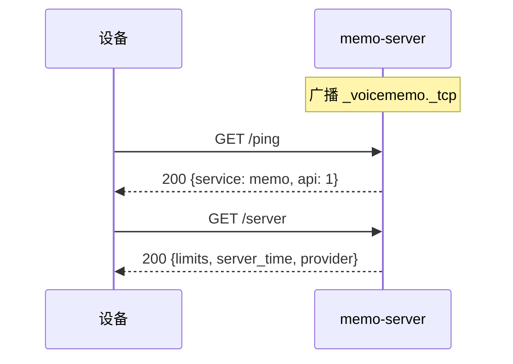
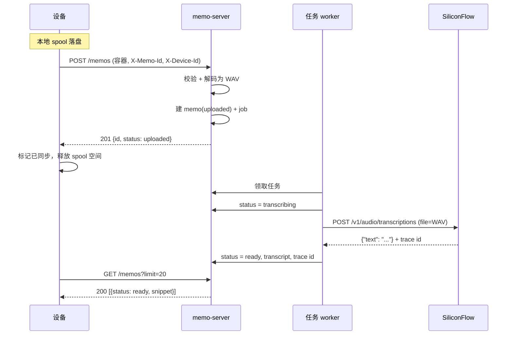
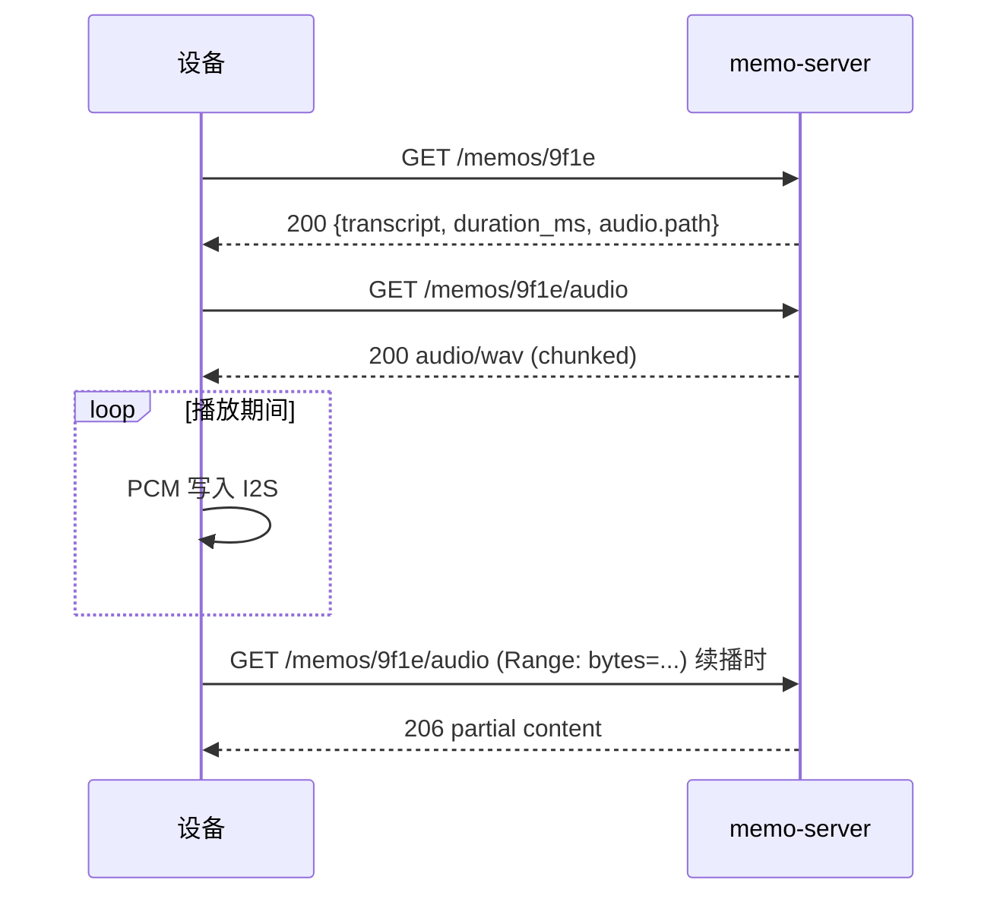
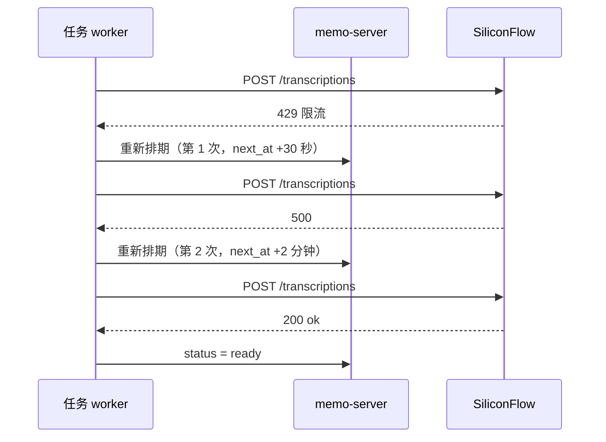
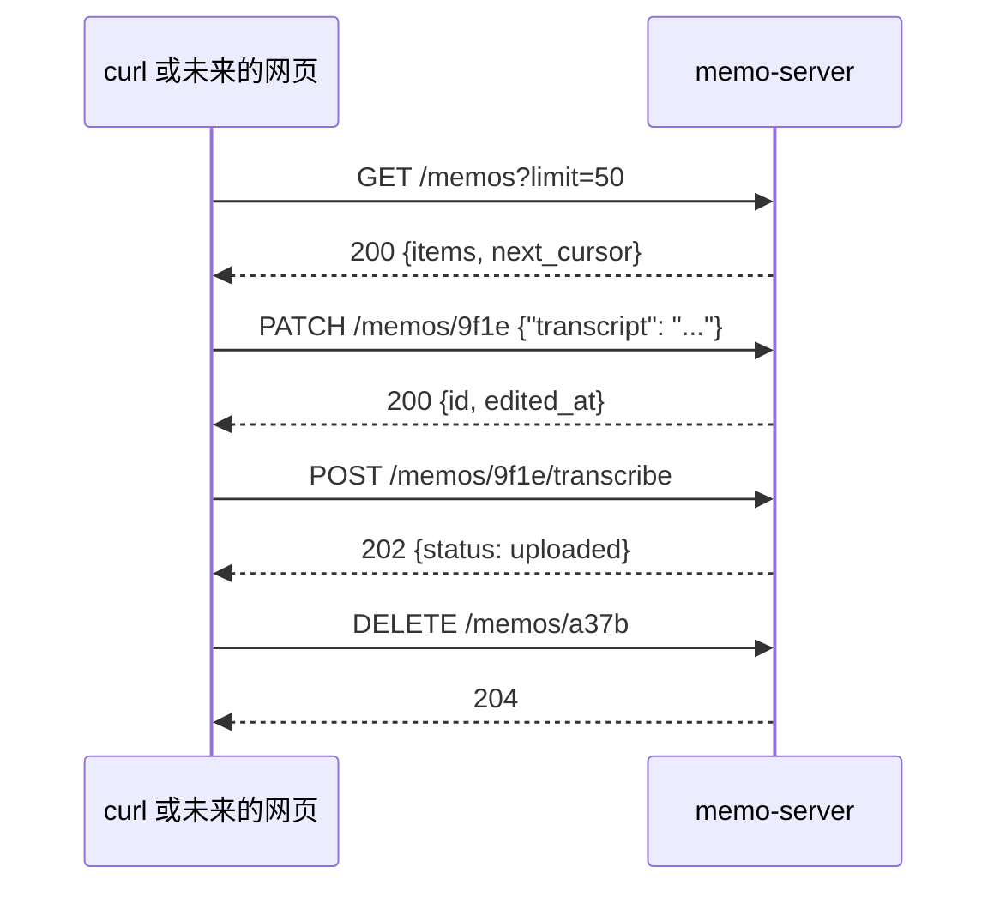

<p align="right">
  <a href="server.md">English</a> · <strong>简体中文</strong>
</p>

# 语音日记服务端 — 技术方案

状态：评审稿，2026-10-26。设备端方案另起一份，本文不涉及。

## 1. 范围

服务端接收 Passport 上传的录音，保存下来，调用托管的语音转写接口把每条录音变成文字，
再把结果列表返回给设备。同时提供完整的日记管理接口，方便用别的工具整理。

范围内：上传校验、音频解码、转写、元数据查询、音频流、备忘录的完整增删改查、
服务发现、部署。

范围外：设备上的录音/播放/界面逻辑、用户账号体系、多租户、Web 界面。

几条塑造了整体设计的非目标：不要消息队列、不要反向代理、不要外部数据库、不要
`ffmpeg`、不要 cgo、不要设备接入协议。一个进程、一个目录、一个二进制。

这是一个可信局域网服务，**没有鉴权**；第 13 节把这个后果直说，不含糊过去。

## 2. 技术选型

| 关注点 | 选择 | 理由 |
| --- | --- | --- |
| 语言 | Go 1.27.3 | 与开发机工具链一致；标准库自带方法路由、`log/slog`、`database/sql` |
| HTTP | `net/http` + `http.ServeMux` | 方法与通配符路由能覆盖全部接口，不需要框架 |
| 记录存储 | SQLite（`modernc.org/sqlite`） | 纯 Go、无 cgo、单文件、WAL |
| 音频解码 | `github.com/pion/opus` | 纯 Go；16 kHz 单声道 SILK 流 bit-exact，正是设备的编码参数 |
| 服务发现 | `github.com/grandcat/zeroconf` | 纯 Go 的 mDNS 发布 |
| 语音转写 | SiliconFlow 转写接口 | 见第 4 节 |
| 构建 | `CGO_ENABLED=0 go build -trimpath -ldflags="-s -w"` | 单个静态二进制，部署无运行时依赖 |

选 `pion/opus` 而不是 cgo 包装，是为了把整个原生工具链从部署里删掉。如果设备将来改用
CELT 或更高码率，`github.com/skrashevich/go-opus` 暴露同一套 API，只需在 `go.mod` 里
加一行 `replace` 就能换；这也是为什么解码被我们自己的函数包了一层，而不是在 handler
里直接调用。

## 3. 进程与包结构

```text
server/
├── cmd/memo-server/main.go     参数、配置、装配、少量 CLI
├── internal/config/            环境变量解析与校验
├── internal/domain/            Memo、Device、Status、容器头
├── internal/audio/             Opus 帧解码、WAV 封装
├── internal/store/             SQLite 查询与文件布局
├── internal/httpapi/           路由、JSON 错误、Range 处理
├── internal/asr/               Transcriber 接口、siliconflow、fake
├── internal/jobs/              单写者任务循环
└── internal/discovery/         mDNS 发布
```

一个进程，三条长驻 goroutine：HTTP 服务、任务 worker、mDNS 广播。其余都是请求级。

## 4. 外部依赖

### 4.1 SiliconFlow 转写

| 项 | 值 |
| --- | --- |
| 端点 | `POST https://api.siliconflow.cn/v1/audio/transcriptions` |
| 鉴权 | `Authorization: Bearer <API key>` |
| 请求体 | `multipart/form-data`：`file`（音频）、`model`（必填） |
| 模型 | `FunAudioLLM/SenseVoiceSmall`（默认）、`TeleAI/TeleSpeechASR`（备选） |
| 限制 | 时长 ≤ 1 小时，文件 ≤ 50 MB |
| 响应 | `{"text": "..."}`，响应头带 `x-siliconcloud-trace-id` |
| 支持格式 | WAV、MP3、OGG、M4A、FLAC |

我们自己的限制比提供方更严：单条 5 分钟、32 MB，在上传处就拦。解码后的 5 分钟 16 kHz
单声道 WAV 是 9.6 MB，两边都留有余量。

API key 只从环境变量读取，绝不写进数据库、日志或响应体。适配器只做两件事：送一个文件，
拿一个字符串；提供方的任何细节都不泄漏出 `asr` 包。

### 4.2 服务发现

mDNS 服务类型 `_voicememo._tcp`，实例名可配置（默认取主机名），TXT 记录带
`ver=1`、`path=/api/v1`、`caps=opus`，广播端口即 HTTP 端口。设备解析到记录后还会请求
`GET /api/v1/ping` 确认可达，所以一条过期的记录不会被误判成可用服务器。

mDNS 依赖组播，过不了 Docker 默认 bridge 网络。部署要么是 systemd 跑原生二进制，
要么容器加 `--network host`。

## 5. 组件接口

真正的抽象只有两处，其余都是具体实现。

### 5.1 语音转写

```go
package asr

type Input struct {
    AudioPath string        // 已解码的 16 kHz 单声道 WAV
    Duration  time.Duration
    Language  string        // "" 表示自动识别
}

type Result struct {
    Text     string
    Language string
    Provider string
    Model    string
    TraceID  string
}

type Transcriber interface {
    Name() string
    Transcribe(ctx context.Context, in Input) (Result, error)
}
```

错误按类型区分，而不是靠匹配字符串：

```go
var ErrPermanent = errors.New("permanent transcription failure") // 不重试
// 包装方式：fmt.Errorf("%w: %v", ErrPermanent, cause)
```

实现：`siliconflow.go`、`fake.go`（返回固定文本，供测试与离线开发）、可选的
`exec.go`（调用本地命令）用来证明这个接口是真接缝。由 `MEMO_ASR_PROVIDER` 选择。

### 5.2 音频解码

```go
package audio

// DecodeOpusToWAV 从 r 读一个 MEMO 容器，把每个 Opus 帧按 16 kHz 单声道解码，
// 并把 RIFF/WAVE 写到 w。返回帧数与解码时长，供调用方与容器头交叉校验。
func DecodeOpusToWAV(r io.Reader, w io.Writer) (Stats, error)
```

这里刻意用函数而不是接口：落盘格式只有一种，真要加第二种编码，容器版本号本来就要变。

### 5.3 存储

`internal/store` 是基于 `*sql.DB` 的具体类型，不是接口。测试直接用临时 SQLite 文件，
比 mock 更快也更诚实。

## 6. 数据模型

```sql
CREATE TABLE devices (
    id          TEXT PRIMARY KEY,          -- 由 MAC 派生的 12 位十六进制
    name        TEXT,
    first_seen  INTEGER NOT NULL,
    last_seen   INTEGER NOT NULL
);

CREATE TABLE memos (
    id           TEXT PRIMARY KEY,         -- UUIDv4，由设备生成
    device_id    TEXT NOT NULL,
    recorded_at  INTEGER NOT NULL,         -- 设备时钟，Unix 秒
    uploaded_at  INTEGER NOT NULL,
    duration_ms  INTEGER NOT NULL,
    frame_count  INTEGER NOT NULL,
    size_bytes   INTEGER NOT NULL,
    codec        TEXT NOT NULL,            -- opus
    status       TEXT NOT NULL,            -- uploaded | transcribing | ready | failed
    transcript   TEXT,
    lang         TEXT,
    asr_provider TEXT,
    asr_model    TEXT,
    asr_trace_id TEXT,
    edited_at    INTEGER,                  -- 人工修正文本时写入
    error        TEXT,
    audio_path   TEXT NOT NULL,
    clock_skew   INTEGER NOT NULL DEFAULT 0,
    deleted_at   INTEGER                   -- 软删除，音频已移除
);

CREATE INDEX memos_order ON memos(recorded_at DESC, id DESC)
    WHERE deleted_at IS NULL;

CREATE TABLE jobs (
    id        INTEGER PRIMARY KEY AUTOINCREMENT,
    memo_id   TEXT NOT NULL UNIQUE,
    attempts  INTEGER NOT NULL DEFAULT 0,
    next_at   INTEGER NOT NULL
);
```

`devices` 没有 token、没有状态：它只用来标明一条记录的来源，第一次见到未知的
`X-Device-Id` 时创建。

文件：`data/audio/<device_id>/<YYYYMM>/<memo_id>.wav`。解码后的 WAV 是唯一的权威副本；
解码成功后上传的 Opus 容器就删掉。解码失败时容器保留在 `data/rejected/` 供排查。

## 7. HTTP API

所有路径前缀 `/api/v1`。除上传体和音频流以外都是 JSON 进、JSON 出。没有鉴权，也没有
按设备隔离：任何调用方都能看到全部备忘录。

| 方法 | 路径 | 用途 |
| --- | --- | --- |
| GET | `/ping` | 发现之后的连通性探测 |
| GET | `/server` | 版本、下发的限制、服务器时间、提供方 |
| POST | `/memos` | 上传一条录音 |
| GET | `/memos` | keyset 分页列表，倒序 |
| GET | `/memos/{id}` | 单条记录含转写文本 |
| PATCH | `/memos/{id}` | 人工修正文本或语言 |
| DELETE | `/memos/{id}` | 删除记录与音频 |
| GET | `/memos/{id}/audio` | WAV 流，支持 `Range` |
| POST | `/memos/{id}/transcribe` | 重新转写 |
| GET | `/health` | 运维视图：队列深度、提供方、磁盘占用 |

管理接口刻意做成 REST 完备：将来网页、脚本、手机快捷指令要做的任何管理动作都能走 HTTP，
CLI 只是便利，不是唯一入口。

### 7.1 设备识别

不注册、不发 token、不审批。设备自带 id：

```http
X-Device-Id: A1B2C3D4E5F6
```

第一次见到未知 id 就建一行设备记录。id 写进每条备忘录并在响应里回显，足够区分两台设备。
读接口允许缺省，上传必须带——没有来源的备忘录事后无法归属。

### 7.2 服务器信息

```http
GET /api/v1/server
```

```json
200 OK
{"service":"memo-server","version":"0.1.0","api":1,
 "server_time":1761468200,
 "asr":{"provider":"siliconflow","model":"FunAudioLLM/SenseVoiceSmall"},
 "limits":{"max_memo_ms":300000,"max_bytes":33554432}}
```

`limits` 放在服务端，是为了让 5 分钟上限只在一处定义，而不是固件和服务各写一份慢慢漂移。

### 7.3 上传

```http
POST /api/v1/memos
Content-Type: application/octet-stream
X-Device-Id: A1B2C3D4E5F6
X-Memo-Id: 9f1e5c7a-...
X-Recorded-At: 1761468120
Content-Length: 192044          （可选；接受 chunked 请求体）

<MEMO 容器字节>
```

```json
201 Created
{"id":"9f1e5c7a-...","status":"uploaded","duration_ms":84000}
```

用同一个 `X-Memo-Id` 重传会返回 `200` 与既有记录，不会产生第二个任务。幂等性正是设备
在超时后可以放心重试的前提。

请求体边收边写到 `data/incoming/<memo_id>.part` 并施加上限，随后校验（第 8 节）、解码、
移到正式位置。校验通过之前不写数据库，所以一次截断的上传只会留下临时文件，由启动清理。

### 7.4 列表

```http
GET /api/v1/memos?limit=20&cursor=MTc2MTQ2MzAyMDpkMWYy&device=A1B2C3D4E5F6
```

```json
200 OK
{"items":[
   {"id":"9f1e...","device_id":"A1B2...","recorded_at":1761468120,
    "duration_ms":84000,"status":"ready","lang":"zh",
    "snippet":"下午三点和张工对了下进度…"},
   {"id":"a37b...","device_id":"A1B2...","recorded_at":1761463020,
    "duration_ms":46000,"status":"transcribing"}
 ],
 "next_cursor":"MTc2MTQ2MzAyMDphMzdi"}
```

`limit` 默认 20、上限 100；`device` 是可选过滤。游标是 `recorded_at:id` 的不透明
base64，因此翻页是 keyset 定位，浏览期间有新记录写入也不会错位。`snippet` 是转写文本的
前 40 个字符（按 rune 边界截断），转写未完成时不返回该字段。

### 7.5 详情、修正与删除

```json
200 OK
{"id":"9f1e...","device_id":"A1B2...","recorded_at":1761468120,
 "uploaded_at":1761468200,"duration_ms":84000,"size_bytes":192044,
 "codec":"opus","status":"ready","lang":"zh","edited_at":null,"error":null,
 "transcript":"下午三点和张工对了下进度，他说下周三之前把测试环境搭好……",
 "asr":{"provider":"siliconflow","model":"FunAudioLLM/SenseVoiceSmall","trace_id":"3f0a…"},
 "audio":{"path":"/api/v1/memos/9f1e.../audio","bytes":2688044}}
```

```http
PATCH /api/v1/memos/9f1e...
Content-Type: application/json

{"transcript":"下午三点和张工对了进度，测试环境下周三前搭好。","lang":"zh"}
```

`PATCH` 接受 `transcript` 和/或 `lang`，写入 `edited_at`，状态保持 `ready`，不会触发转写。
未知字段直接拒绝而不是静默忽略，管理脚本里的拼写错误才会当场暴露。

`DELETE` 返回 `204`，不可撤销：行被软删除，音频文件立即移除。删除不存在的 id 返回 `404`。

`POST /memos/{id}/transcribe` 返回 `202`，清空 `error`、把状态改回 `uploaded` 并重新入队。
提供方故障之后，这就是那个手动补救入口。

`GET /memos/{id}/audio` 返回 `audio/wav`，带 `Accept-Ranges: bytes`，支持单个 `Range`
头。设备是从头播的，但 Range 让这个接口更诚实，也方便调试时反复听。

### 7.6 错误

```json
{"error":{"code":"bad_container","message":"unexpected magic"}}
```

| code | 状态码 | 含义 |
| --- | --- | --- |
| `not_found` | 404 | 未知 memo id |
| `invalid_json` | 400 | 请求体格式错误或含未知字段 |
| `missing_device` | 400 | 上传缺少 `X-Device-Id` |
| `bad_container` | 400 | 魔数、版本或字段不匹配 |
| `frame_mismatch` | 400 | 声明的帧数或时长与实际不符 |
| `payload_too_large` | 413 | 超过 `MEMO_MAX_BYTES` |
| `over_limit` | 400 | 时长超过 `max_memo_ms` |
| `internal` | 500 | 未预期错误，细节只进日志 |

## 8. 上传容器

在这里定义一次，两端各自实现。所有整数小端。

| 偏移 | 长度 | 字段 |
| --- | ---: | --- |
| 0 | 4 | 魔数 `MEMO` |
| 4 | 1 | 版本，当前 1 |
| 5 | 1 | 编码，1 = Opus |
| 6 | 2 | 采样率，16000 |
| 8 | 1 | 声道数，1 |
| 9 | 1 | 帧长（毫秒），60 |
| 10 | 2 | 保留，0 |
| 12 | 4 | 时长（毫秒） |
| 16 | 8 | `recorded_at`，Unix 秒，0 表示从未对时 |
| 24 | 32 | memo id，ASCII UUID，不足补 0 |
| 56 | 4 | 帧数 |
| 60 | 20 | 保留，0 |
| 80 | … | 帧：先 `uint16` 长度，再负载，循环 |

以下情况拒绝上传：魔数、版本、编码、采样率或声道数与上表不符；声明的帧数与实际帧数不符；
时长与 `frame_count × frame_ms` 相差超过 5%；请求体超过字节上限。这类拒绝都是永久性的，
设备不应重试。

## 9. 处理流程

```text
上传 ──► 校验容器 ──► 解码帧 ──► 写 WAV ──► 建行(uploaded) + 任务
                                                  │
                            任务 worker 领取 ◄────┘
                                     │
                     status=transcribing ─┤
                                          ▼
                           asr.Transcribe(WAV) ── 成功 ──► status=ready + 文本
                                          └── 失败 ──► 退避重试，超限则 failed
```

解码放在上传请求里做：5 分钟文件解码是几十毫秒，换来的是状态机更小——只有音频确认可用，
memo 行才存在。

转写是异步的。设备从不等它，只在下一次刷新列表前显示一个"转写中"圆点。

### 9.1 任务循环

由一个 goroutine 领取任务；`MEMO_ASR_CONCURRENCY` 可以在提供方允许并发时调大。

```sql
UPDATE jobs SET attempts = attempts + 1, next_at = ?
WHERE id = (SELECT id FROM jobs WHERE next_at <= ? ORDER BY id LIMIT 1)
RETURNING memo_id, attempts;
```

退避 30 秒、2 分钟、10 分钟，之后置 `failed`，把提供方给的原因写进 `memos.error`。
`ErrPermanent` 直接跳过剩余尝试。启动时把停留在 `transcribing` 的行改回 `uploaded` 并
重新入队——这就是崩溃恢复，不需要任何外部状态。

### 9.2 时钟处理

`recorded_at` 来自设备，从未对时成功的设备会送 `0`。当它为 0、或与服务器时间相差超过
10 分钟时，服务器改用自己收到的时刻，并把差值记进 `clock_skew`。排序始终用
`recorded_at`，所以时钟不准的设备只是退化成上传顺序，而不会把日记打乱。

## 10. 交互时序图

### 10.1 启动与发现



### 10.2 录音、上传、转写



### 10.3 浏览与播放



### 10.4 提供方失败



### 10.5 从其它工具做管理



## 11. CLI

```text
memo-server serve     启动 HTTP、任务与发现
memo-server gc        清理孤儿文件、过期临时文件、过期记录
```

管理动作放在 HTTP 接口里而不是 CLI 里：这样第二台机器、脚本、未来的网页，与坐在主机前的
操作者权限完全一致。CLI 只保留 HTTP 做不到的事情（垃圾回收）。

## 12. 配置

| 变量 | 默认值 | 含义 |
| --- | --- | --- |
| `MEMO_ADDR` | `:8080` | 监听地址 |
| `MEMO_DATA_DIR` | `./data` | 数据库与音频根目录 |
| `MEMO_MDNS_NAME` | 主机名 | 广播实例名 |
| `MEMO_ASR_PROVIDER` | `siliconflow` | `siliconflow`、`fake`、`exec` |
| `MEMO_ASR_API_KEY` | — | 提供方密钥，真实提供方必填 |
| `MEMO_ASR_MODEL` | `FunAudioLLM/SenseVoiceSmall` | 提供方模型 |
| `MEMO_ASR_BASE_URL` | `https://api.siliconflow.cn` | 便于测试时改指向 |
| `MEMO_ASR_CONCURRENCY` | `1` | 并发转写任务数 |
| `MEMO_MAX_BYTES` | `33554432` | 上传字节上限 |
| `MEMO_MAX_MEMO_MS` | `300000` | 下发给设备的时长上限 |
| `MEMO_RETENTION_DAYS` | `0` | `0` 表示永久保留 |
| `MEMO_LOG_LEVEL` | `info` | `debug`、`info`、`warn`、`error` |

提供方需要密钥而密钥缺失时，启动直接失败，而不是接受一批注定转写不了的上传。

## 13. 安全定位

没有鉴权。任何能连到这个端口的人都能读全部备忘录、下载全部录音、改写转写文本、删除条目。
对一台单用户的家庭局域网服务器来说，这是被接受的取舍，但它应当写在文档里，而不是以后变成
一个意外。

仍然保留的几项约束，因为它们不花成本：

- 上传在流式收取过程中就施加上限，不是先缓冲整个请求体再判断。
- memo id 在触碰文件系统前先校验为 UUID，因此路径穿越在构造上不可能发生。
- 提供方密钥在启动时从环境读取，永不出现在日志、错误或 HTTP 响应里。
- 上表之外的方法一律拒绝，避免一个误发的 `PUT` 把记录改成半新半旧。

如果哪天要离开局域网：在前面加一层做 TLS 的反向代理加共享密钥或 mTLS，并在
`POST /memos` 与读接口上要求设备 token。数据模型不会挡这条路。

## 14. 部署

```bash
CGO_ENABLED=0 go build -trimpath -ldflags="-s -w" -o memo-server ./cmd/memo-server
```

```ini
# /etc/systemd/system/memo-server.service
[Service]
Environment=MEMO_DATA_DIR=/var/lib/memo
Environment=MEMO_ASR_API_KEY=...
ExecStart=/usr/local/bin/memo-server serve
Restart=always
```

备份就是 `data/`（SQLite 加音频）：运行中用 `sqlite3 memo.db ".backup"`，再复制音频目录。
恢复是反向操作，除此之外没有别的状态。升级只需换二进制并重启；数据库迁移在启动时执行，
且是幂等的。

容器镜像可选；如果用，需要 `--network host` 才能发布 mDNS。

## 15. 测试

| 层级 | 覆盖内容 |
| --- | --- |
| `internal/audio` | 容器解析、声明帧数与实际不符、WAV 头字段、一小段 SILK 素材的解码、时长换算 |
| `internal/domain` | 容器头往返、时钟偏移规则、状态迁移 |
| `internal/httpapi` | 上传幂等、游标分页、`PATCH` 字段校验、`DELETE` 幂等、`Range` 请求、错误码——全部走 `httptest` |
| `internal/asr` | `fake` 全链路；提供方适配器对 `httptest` 服务器校验 multipart 形状、重试分类、trace id 捕获 |
| `internal/jobs` | 退避时间表、永久错误的短路、`transcribing` 行的崩溃恢复 |
| `internal/store` | 真实临时 SQLite，写入期间并发读，软删除过滤 |

`go test ./...` 不需要网络即可全绿。一个素材文件
（`internal/audio/testdata/one-second.opus`）用 `ffmpeg` 按 16 kHz 单声道 SILK 生成一次
后提交，让解码路径在没有真实提供方的情况下也有覆盖。

## 16. 待定

1. **保留策略。** `MEMO_RETENTION_DAYS` 已存在，但还没有自动清理。删除日记条目属于产品
   决策，所以默认永不删除，删除始终是显式动作。
2. **提供方回退。** SiliconFlow 失败后要不要自动切到第二家，还是保持失败直到有人调用
   `POST /memos/{id}/transcribe`。
3. **搜索。** `GET /memos` 目前只按设备和时间过滤。要检索转写文本需要 SQLite FTS5，
   暂时不需要，而且它会改变索引布局。
